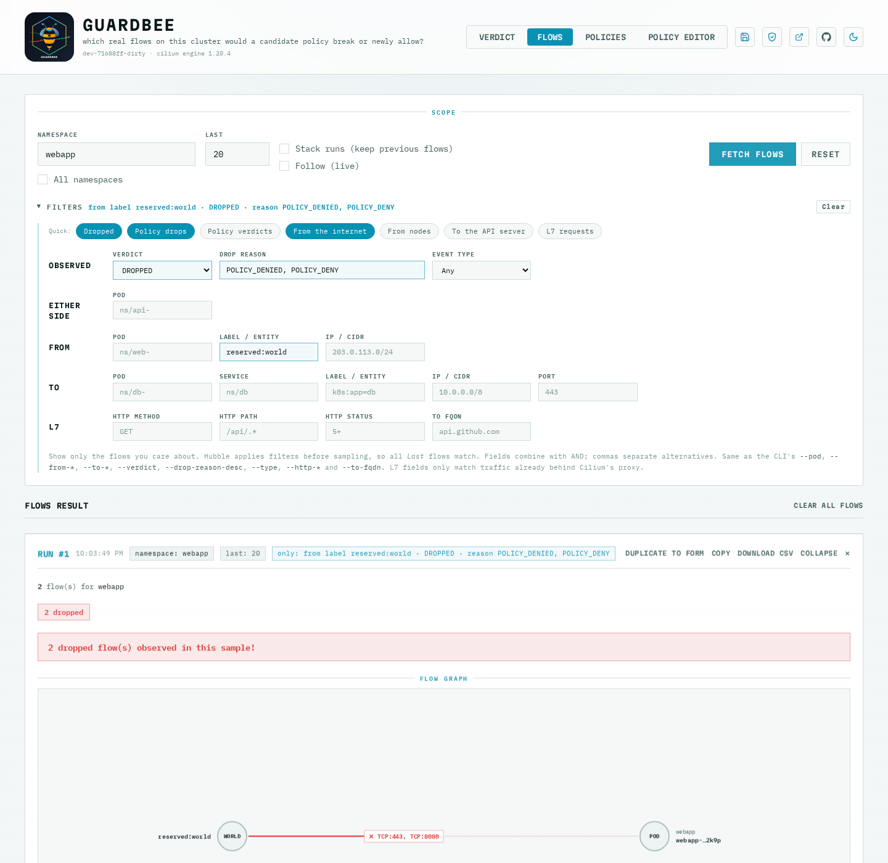
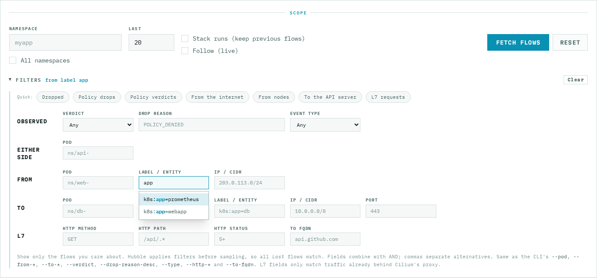
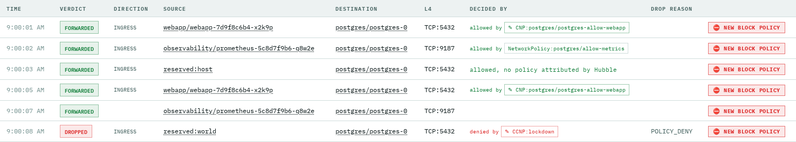
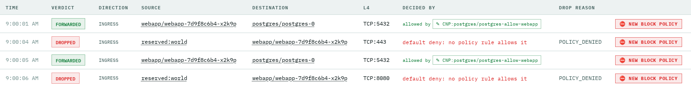
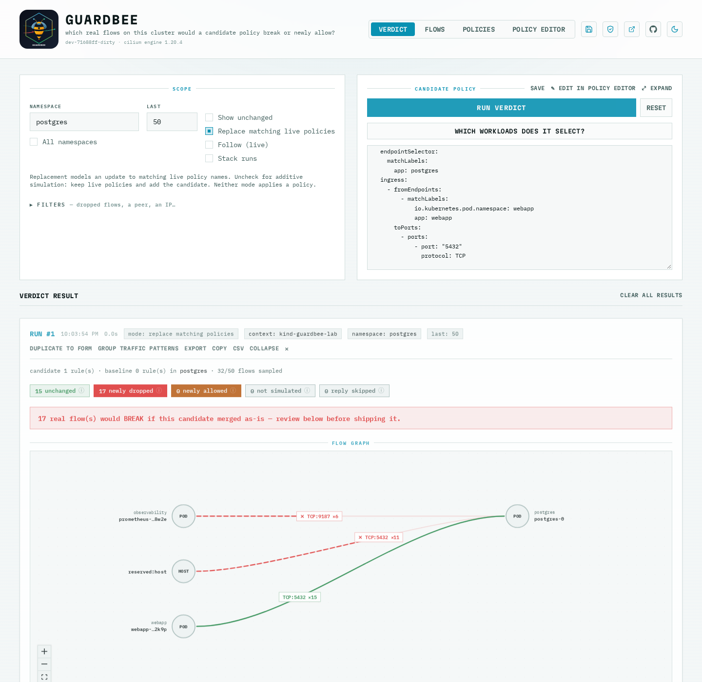
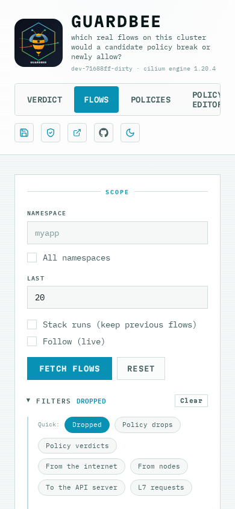

# Commands

All of these are read-only against the cluster by default. Explicitly opted-in
UI connectivity tests in Verdict append ephemeral containers to generate TCP/UDP
traffic for a verdict run's candidate; see [Connectivity tests](tcp-probes.html).

## `policies`

Lists live policies touching a namespace.

```
guardbee policies [-n <namespace>|-A]
```

| Flag | Meaning |
|---|---|
| `-n`, `--namespace` | One namespace's CNPs |
| `-A`, `--all-namespaces` | Every namespace's CNPs, plus cluster-wide CCNPs |

> Uses the generated Cilium clientset — a direct read, nothing hand-parsed.

---

## `flows`

Streams real traffic from Hubble.

```
guardbee flows [-n <namespace>|-A] [--pod|--from-*|--to-*|--verdict|--drop-reason-desc|--type ...] [--last N] [-f]
```

| Flag | Meaning |
|---|---|
| `-n`, `--namespace` / `-A`, `--all-namespaces` | Scope flows to one namespace or every namespace |
| `--last N` | Ceiling on flows fetched — Hubble's ring buffer may hold fewer |
| `-f`, `--follow` | Keep tailing new flows until Ctrl+C, instead of stopping after `--last` |
| `--pod` | Only flows where a pod with this name prefix is the source **or** the destination, like `hubble observe --pod` |
| `--from-pod`, `--from-label`, `--from-ip` | Only flows from that source: a pod name prefix, a label or entity (`k8s:app=web`, `reserved:world`), or an IP/CIDR |
| `--to-pod`, `--to-service`, `--to-label`, `--to-ip`, `--to-port` | Only flows going to that destination, the same way |
| `--verdict` | Only flows with this observed verdict: `FORWARDED`, `DROPPED`, `AUDIT`, `ERROR`, `REDIRECTED`, `TRACED`, `TRANSLATED` |
| `--drop-reason-desc` | Only flows dropped for this reason, e.g. `POLICY_DENIED`, `POLICY_DENY` (Cilium's `flow.DropReason` names) |
| `--type` | Only events of this Hubble type: `policy-verdict`, `drop`, `trace`, `l7`, … (hubble's own names) |
| `--hubble-addr host:port` | Dial hubble-relay at this address instead of port-forwarding to its pod. Plaintext gRPC, like the port-forward. Also on `blame` and `verdict` |

All filter flags use `hubble observe`'s own names and semantics. They're repeatable: repeats of one flag are ORed, different flags ANDed. A bare pod/service name means the `-n` namespace (with `-A`, the `default` namespace, as in hubble). One difference: hubble refuses `--pod` together with `--from-pod`/`--to-pod`/`--to-ip`; here they simply AND, so `--pod web --to-ip 10.0.0.1` is web's own traffic to that IP. They're applied in Hubble's query, so `--last 50` means 50 *matching* flows. Dropped flows also print their drop reason.

```
guardbee flows -n myapp --verdict DROPPED --drop-reason-desc POLICY_DENIED
guardbee flows -n myapp --from-label reserved:world --to-port 443 -f
guardbee flows -A --from-ip 10.0.0.0/8 --verdict DROPPED
```

The UI's **Flows** tab has the same filters (under **Filters**) plus a **Follow (live)** option, and each run card shows the filter it ran with. A followed run keeps its newest 2000 flows. **Quick** buttons set common filters in one click (Dropped, Policy drops, Policy verdicts, From the internet, From nodes, To the API server). Each row also shows its **Direction** and **Decided by**, the same attribution `blame` prints. As you type, each field autocompletes from the traffic already fetched: pods (as workload prefixes like `app/web-` and as exact names), the identity labels Hubble reported (`k8s:app=web`, `reserved:world`), ports, verdicts, and every drop reason Cilium defines.

<div class="shot">
<div class="shot-titlebar"><span class="shot-dot red"></span><span class="shot-dot yellow"></span><span class="shot-dot green"></span><span class="shot-label">guardbee ui · flows — filters</span></div>

</div>

<div class="shot">
<div class="shot-titlebar"><span class="shot-dot red"></span><span class="shot-dot yellow"></span><span class="shot-dot green"></span><span class="shot-label">guardbee ui · flows — autocomplete</span></div>

</div>


> Port-forwards to the cluster's `hubble-relay` pod (`cilium-system`) and streams via Hubble's `Observer.GetFlows` gRPC API. With `--hubble-addr` it dials the address you give instead, which needs no `pods` or `pods/portforward` RBAC. That suits an in-cluster CI runner reaching the `hubble-relay` Service directly, e.g. `--hubble-addr hubble-relay.cilium-system.svc:80`.

---

## `blame`

Which live policy allowed or denied real traffic. Nothing is simulated: this reads the attribution Cilium's own agent attaches to each Hubble `policy-verdict` event (`ingress_allowed_by`, `egress_denied_by`, …), like `hubble observe --pod X --type policy-verdict -o json | jq`, without the `jq`.

```
guardbee blame [[namespace/]<pod-name>] [-n <namespace>|-A] [--pod|--from-*|--to-*|--verdict|--type ...] [--last N] [-f] [--format table|json|markdown]
```

| Flag | Meaning |
|---|---|
| `[namespace/]<pod-name>` | Same as `--pod`: flows where that pod is the source or the destination. Without `-n`/`-A`, its namespace becomes the scope |
| `--type` | Defaults to `policy-verdict`, the only event Cilium attributes; pass another type to see other events (with no attribution) |
| `--format` | `table` (default), `json` (one object per line with `--follow`), or `markdown` (one-shot only) for a ticket |
| everything else | Same as `flows` |

```
guardbee blame myapp/api
guardbee blame -n myapp api --verdict DROPPED
guardbee blame myapp/netshoot --to-ip 169.254.169.254 -f
guardbee blame -A --verdict DROPPED --format markdown
```

Each line shows the verdict, the side it was taken on (`INGRESS`/`EGRESS`), and who decided:

| Decided by | Meaning |
|---|---|
| `allowed by CNP:ns/name, CCNP:name` | The policies whose rules allowed it |
| `denied by CNP:ns/name` | An explicit deny rule (`ingressDeny`/`egressDeny`) dropped it |
| `denied by a deny rule, not attributed by Hubble` | Dropped as `POLICY_DENY` (a deny rule matched), but Hubble couldn't say which |
| `default deny: no policy rule allows it` | Dropped as `POLICY_DENIED`: the endpoint is selected by some policy, but no rule allows this peer/port. The fix is an allow rule, not hunting for a deny rule |
| `audit: would be denied by …` | Audit mode let it through; enforcement would drop it |
| `allowed, no policy attributed by Hubble` | Allowed, but Hubble attached no policy. It doesn't prove no policy selects the endpoint, so it isn't reported as such |

Kinds are Cilium's own: `CNP`, `CCNP`, or spelled out (`NetworkPolicy:ns/name`). Attribution needs Hubble's policy correlation, which is on by default (`hubble-network-policy-correlation-enabled`). It can also be missing for flows with no port.

In the UI's **Flows** tab, the **Policy verdicts** quick filter and the **Either side → Pod** field give the same view. Each `✎ CNP:`/`✎ CCNP:` badge opens that live policy in the **Policy Editor**, ready to fix and run through Verdict.

<div class="shot">
<div class="shot-titlebar"><span class="shot-dot red"></span><span class="shot-dot yellow"></span><span class="shot-dot green"></span><span class="shot-label">guardbee ui · flows — decided by</span></div>

</div>

<div class="shot">
<div class="shot-titlebar"><span class="shot-dot red"></span><span class="shot-dot yellow"></span><span class="shot-dot green"></span><span class="shot-label">guardbee ui · flows — default deny</span></div>

</div>

---

## `verdict`

The engine. Diffs a candidate policy against live traffic — judged once against today's policy, once with the candidate added.

```
guardbee verdict [-n <namespace>|-A] [--pod|--from-*|--to-*|--verdict|--drop-reason-desc|--type ...] [--last N] [-f] <candidate.yaml>... | -
```

| Flag | Meaning |
|---|---|
| `-n`, `--namespace` | Right for a CNP candidate — it can only ever affect its own namespace |
| `-A`, `--all-namespaces` | Right for a CCNP candidate — it can span namespaces, so sampling needs to as well |
| `--last N` / `-f`, `--follow` | Same as `flows` |
| `--pod`, `--from-*`, `--to-*`, `--verdict`, `--drop-reason-desc`, `--type` | Same as `flows`: judge only matching flows. `--verdict` is the flow's verdict *today*, so `--verdict DROPPED` asks which of today's drops the candidate would newly allow |
| `--show-unchanged` | Also print `UNCHANGED` rows (default: just a count) |
| `--replace-existing` | Judge the candidate as replacing a live policy with the same kind, namespace and name, instead of adding it on top |
| `--fail-on-dropped` | Exit `2` if any sampled flow is `NEWLY_DROPPED` |
| `--per-policy` | Judge each CNP/CCNP document on its own: one section per policy and an overall exit code that is the worst of them. One-shot only |
| `--fail-on-allowed` | Exit `4` if any sampled flow is `NEWLY_ALLOWED` (a dropped flow outranks it) |
| `--fail-on-l7` | Exit `5` if any sampled flow is `L7_CHANGED` (dropped and newly allowed flows outrank it) |
| `--min-flows N` | Exit `3` if fewer than N flows were judged (replies and not-simulated flows don't count) |
| `--format table\|json\|markdown` | Output format; `json` and `markdown` are one-shot only |

> Output is four buckets: `NEWLY_DROPPED`, `NEWLY_ALLOWED` and `L7_CHANGED` (each with a one-line plain-English reason), and `UNCHANGED`. `L7_CHANGED` means the flow is allowed at L4 either way, but the L7 proxy would check its requests against different rules; the rules are shown in brackets (`[L7 no L7 rules → ingress: HTTP GET /healthz]`). DNS queries Hubble recorded are judged one by one: a query the candidate's DNS rules would refuse is `NEWLY_DROPPED`, named in brackets (`[L7 DNS api.github.com.; egress: DNS * → egress: DNS *.example.com]`). HTTP requests Hubble recorded are judged too, against the exact Envoy rules Cilium generates, and marked `(matched by GuardBee, not Envoy)` since Envoy's own matching is C++ (`--format json`: `"l7Judge": "guardbee"`). If Hubble redacts URL queries on the cluster (`hubble-redact-http-urlquery`), or the `cilium-config` ConfigMap can't be read to check, HTTP requests are left unjudged and the row says why. See [how verdict works](how-it-works.html) for the engine mechanics.

`<candidate.yaml>` may hold several `---`-separated policies, like a file for `kubectl apply -f`; they're judged together as one candidate. On the CLI, documents of any other kind (a ConfigMap or Deployment in rendered kustomize output) are skipped with a warning on stderr; a file with no policy at all is an error. Pass several files, or `-` to read stdin. A CiliumNetworkPolicy without `metadata.namespace` (kustomize adds it later) can't be placed from the file alone, so pass `-n`. In the UI, a row's **Allow / Deny** button uses this: it shows the affected workload's detected identity labels, and appends a separate exception policy scoped to the labels you pick (with `enableDefaultDeny` off for that direction, so it never default-denies anything on its own). Then it re-runs the verdict.

The filters are applied in Hubble's query, not to the results, so all `--last` flows match instead of a quiet destination getting a handful of the cluster-wide buffer. For example, `guardbee verdict -n myapp --to-label reserved:kube-apiserver --to-port 443 candidate.yaml`. The UI's **Filters** section (under Scope, the same component as the Flows tab's) does the same, and each run card shows the filter it ran with. Its fields suggest values seen in earlier runs: workload pod prefixes, entities, Services, labels and ports, most-seen first. Traffic the filter leaves out isn't judged at all, so a filtered run is for investigating one path, not for signing off on a policy.

### Editing an existing policy

By default the candidate is added on top of the live policy set, including a live policy with the same name. When the candidate is an edit of a live policy, pass `--replace-existing`: the live copy is left out of the candidate side, which is what applying the edit does. Without it, rules the edit removes or narrows still allow traffic, and the regression is not reported. Matching uses the policy labels Cilium's own parser attaches (kind, namespace, name), so a same-name policy in another namespace is never replaced.

### Several policies in one run

By default every policy document is one merged candidate. For a rendered file with several independent policies, `--per-policy` judges each on its own against the same sampled flows (Hubble is sampled once), prints a section per policy, and exits with the worst result across them, ranked dropped (`2`), then newly allowed (`4`), then L7 changed (`5`), then too few flows (`3`), then pass:

```
kustomize build overlays/prod | guardbee verdict -n myapp --per-policy --replace-existing --fail-on-dropped --min-flows 20 -
```

`--format json` then prints `{"policies": [...], "result", "exitCode"}`, each entry the same object a single run prints, and `--format markdown` prints an overall line followed by one section per policy. The shape follows the flag, not the number of policies, so a pipeline parsing it never has to guess. Documents that aren't policies are skipped with a warning.

### CI mode

For a pull-request check:

```
guardbee verdict -n myapp --replace-existing --fail-on-dropped --min-flows 20 --format markdown candidate.yaml
```

| Exit code | Meaning |
|---|---|
| `0` | No gate tripped |
| `1` | Error (cluster, Hubble or candidate) |
| `2` | `--fail-on-dropped`: at least one sampled flow is `NEWLY_DROPPED` |
| `3` | `--min-flows`: too few flows judged to call it a pass (a dropped or newly allowed flow outranks this) |
| `4` | `--fail-on-allowed`: at least one sampled flow is `NEWLY_ALLOWED` (a dropped flow outranks this) |
| `5` | `--fail-on-l7`: at least one sampled flow is `L7_CHANGED` (dropped and newly allowed flows outrank this) |

`--format json` prints the same object as the UI's `POST /api/verdict`, plus `candidate`, `replacedPolicies`, `judgedFlows`, `minFlows`, `result` (`pass`, `dropped`, `allowed`, `l7-changed` or `insufficient-flows`) and `exitCode`. `--format markdown` prints a summary ready to post as a PR comment: a status line, the counts, a table of changed rows, and unchanged rows in a collapsed section.

A pass only covers flows that were in Hubble's buffer at run time. Use `--min-flows` so a quiet namespace reads as inconclusive, not clean.

---

## `ui`

A local web UI for the same engine — pick a namespace, build or paste a candidate, see the verdict as a graph.

```
guardbee ui [--addr host:port] [--enable-probes [--probe-images-file catalog.yaml | --probe-image repository:tag]]
```

`--enable-probes` turns on connectivity tests in Verdict. The browser picks
the probe image from a catalog the server was started with: the built-in
vetted one by default, `--probe-images-file` to replace it, or `--probe-image`
for exactly one image. See [Connectivity tests](tcp-probes.html).

> Calls the exact same `computeVerdict`/`fetchFlows`/`flowAttribution` functions the CLI uses — never a parallel implementation, so the UI and CLI can't disagree on an answer for the same input. The React/TypeScript frontend is embedded into the binary via `go:embed` (the same pattern Argo CD's own UI uses), so the shipped artifact is one executable — no separate frontend server or Node runtime at runtime.

Your work in progress is kept in the browser (localStorage), never sent to the cluster. The Policy Editor draft and the Verdict tab's candidate, namespace and scope auto-save, so a reload restores them. Verdict results aren't restored: they're snapshots of live traffic. **💾 Save** (Verdict candidate box or Policy Editor output) adds a named entry to **Saved policies** (header icon). From there you can reopen an entry in Verdict or the Editor, rename, duplicate or delete it, or download it as `.yaml`.

From the Verdict tab, **✎ Edit in Policy Editor** (above the candidate) opens the candidate there to edit visually; **Test in Verdict Simulator** brings it back. A candidate with several policies, or with rules the visual editor can't represent (L7 HTTP/DNS rules, `toFQDNs`, TLS/SNI, scoped deny rules), stays in Verdict with the reason shown instead of losing those rules, and an unsaved editor draft is only replaced after you confirm. To import a policy into the Policy Editor, paste it into **⤢ Expand / Edit**. The text stays exactly as you typed or pasted it, and the editor updates whenever it parses. **💾 Save** inside that box saves the text itself. That includes a policy the visual editor can't represent, and a paste with several `---`-separated policies; those are saved as-is and open in Verdict.

To keep the browser responsive, a graph with more than 150 nodes or 300 edges isn't drawn automatically. You'll see a message instead, naming the filters that narrow the sample, and **Draw anyway** draws it. The table under the graph still lists every row. When runs are stacked, only the 3 newest expanded runs draw their graphs; older runs have a **Show graph** button. The header shows the binary's version and the Cilium engine it embeds.

Both graphs (Verdict and Flows) draw each peer as a round node labelled by
what it is: `POD`, `HOST`, `WORLD`, `API` (kube-apiserver), `NODE`, `IP`. A
link that reaches its destination is drawn end to end. A blocked link stops
at a ✕ on its port label, with a faint line showing where it was going. In
Verdict, red links are `NEWLY_DROPPED`, amber `NEWLY_ALLOWED`, green still
allowed, and grey still blocked. In Flows, green is `FORWARDED`, red
`DROPPED`, and amber `AUDIT` (marked `!`). Only links that matter move:
in Verdict the links the candidate changes, and in either graph every link of
the node you select. Everything else stays still, and nothing moves at all
with reduced motion turned on. The connectivity test result in Verdict uses
the same picture for its single connection, with one lane for the live
baseline and one for the candidate.

The Verdict tab puts the scope and the candidate policy side by side, with results and graphs at full width below. Every tab also works at phone width.

<div class="shot">
<div class="shot-titlebar"><span class="shot-dot red"></span><span class="shot-dot yellow"></span><span class="shot-dot green"></span><span class="shot-label">guardbee ui · verdict</span></div>

</div>

<div class="shot">
<div class="shot-titlebar"><span class="shot-dot red"></span><span class="shot-dot yellow"></span><span class="shot-dot green"></span><span class="shot-label">guardbee ui · phone width</span></div>

</div>

---

## `version`

Prints the version this binary was built from and the Cilium version its engine is pinned to. When a kubeconfig is available it also prints the Cilium version running on that cluster, read-only via hubble-relay (the same detection behind the version-skew warning), with a 5-second timeout. Without a kubeconfig, or with `--client`, it never touches the cluster.

```
guardbee version
guardbee dev-9435dd8
cilium engine 1.20.4 (pinned)
cilium cluster 1.20.4 (context: kind-guardbee-lab)
```

| Flag | Meaning |
|---|---|
| `--client` | Only print this binary's own versions; don't contact the cluster |
| `--kubeconfig` | Path to kubeconfig (default: `KUBECONFIG` env or `~/.kube/config`) |

The cluster line says `unknown` when hubble-relay can't be reached or is too old to report a version, notes when the cluster differs from the pinned engine at major.minor, and lists every version when nodes disagree (a rolling upgrade).

The build version itself:

| Build | Output |
|---|---|
| A released binary | the published tag, e.g. `v0.3.0` |
| `mise run build` | `dev-<short-sha>`, plus `-dirty` if the working tree has uncommitted changes |
| Plain `go build` (no `-ldflags`) | `dev-unknown` |
