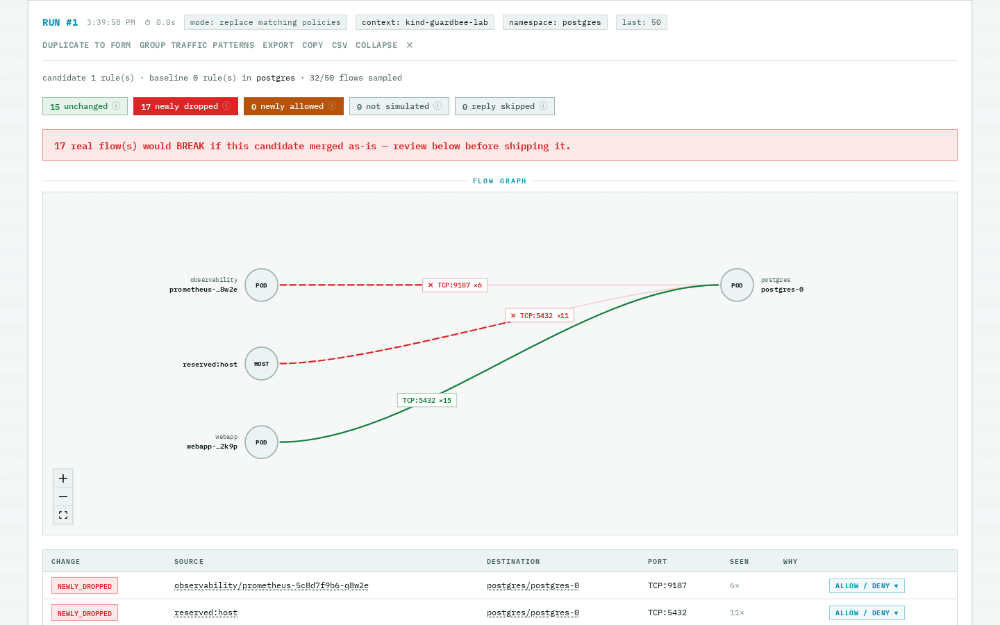
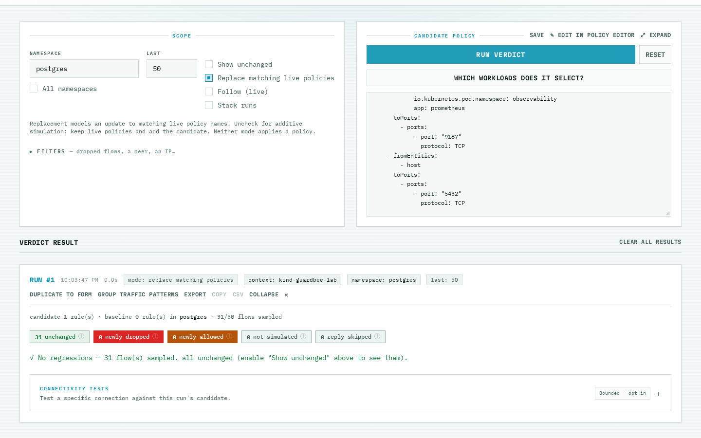

# How `verdict` works

Every sampled flow is judged twice — once against the real baseline
CNPs/CCNPs, once against baseline+candidate — using Cilium's own
`pkg/policy` engine (the same `.Parse()` conversion the real agent uses, not
a reimplementation). Flow identities come directly from Hubble's own
resolved `Endpoint.Identity`, so no separate `CiliumIdentity` lookup is
needed.

---

## Known v1 simplifications

Documented in code, not silent:

| Simplification | What it means |
|---|---|
| Egress scope | A flow must pass the destination's ingress policy and the source's egress policy. Egress is judged on identities, CIDRs, entities, ports and `toFQDNs` names. |
| `toFQDNs` selectors | Cilium labels an IP's identity `fqdn:<selector>` only for selectors already in a live policy. GuardBee adds the label a candidate selector would get by matching it, with Cilium's own pattern rules, against the names Hubble recorded for the destination (`destination_names`), so a new name or a reworded selector (`*.github.com` vs `api.github.com`) is judged before it is live. Hubble knows those names only when the source's DNS goes through Cilium's DNS proxy (a `rules.dns` rule); without them, a flow the candidate would drop is counted `not simulated` instead of guessed. The names are the source pod's own lookups, where Cilium uses every pod's. A `toFQDNs` with no `rules.dns` anywhere in the candidate gets a warning. |
| L7 requests | A DNS query Hubble recorded behind the DNS proxy is judged by name against the DNS rules, with Cilium's own `matchpattern` semantics (`*` is one label, `**.` spans several). An HTTP request is judged against the exact Envoy rules Cilium generates; the matching itself is GuardBee's, following Envoy (C++), so those rows say "matched by GuardBee, not Envoy". Rules outside what GuardBee models (deny or tiered rules, Envoy listeners, SNI, secret-backed header values, a header Hubble redacted) leave a request unjudged, and so does query redaction in Hubble (path rules match the query). A flow with no request record, but under different L7 rules, is `L7_CHANGED` with both rule sets named. L7 responses count as replies. Requests are only visible once their traffic already goes through Cilium's proxy today. |
| Reply packets | Skipped (`reply (skipped)` in the summary) — connection tracking always allows those regardless of CNP ingress rules. |
| Real identities only | Candidate labels with no matching live pod are never exercised by any sampled flow — GuardBee never invents a fake identity. |
| `--last` is a ceiling | Hubble's flow buffer is a small recent-flow ring, not persisted history — it may hold fewer flows than requested. Use `--follow` to accumulate more over time instead of raising `--last` further. |
| `blame` reads Hubble's attribution | `blame` doesn't run the engine: it shows the policy Cilium's agent attributed each policy-verdict event to. When Hubble attached none, it says "not attributed" instead of guessing; only a `POLICY_DENIED` drop is reported as default deny. |
| `--pod` combines freely | Unlike `hubble observe`, `--pod` can be combined with `--from-pod`, `--to-pod` and `--to-ip`; every filter ANDs. |
| Port-0 TCP/UDP flows | Counted as `not simulated` — Cilium's own policy engine can't be queried with a wildcard port, so a flow Hubble reports with no concrete destination port isn't guessed at. |

> A `0 newly dropped` result can mean "nothing in the sample touched the port
> you changed," not "nothing would break" — re-run, raise `--last`, or use
> `--follow` if a result looks too clean.

---

## Two regressions it caught

Both are real runs against the self-paced [Lab](lab.html)'s own cluster —
not synthetic fixtures, and reproducible on your own machine.

### Scoped-too-narrow Postgres allow

A `CiliumNetworkPolicy` that correctly allows an app's traffic to its
database — and looks completely reasonable — but silently breaks a
Prometheus scrape and kubelet's own health probe on the same pod. The
[Lab](lab.html) walks through this exact candidate end to end:

<p class="img-row">
  
  
</p>

> Left: looks correct, isn't. Right: same candidate, fixed — every real
> flow unchanged. `examples/postgres-wrong-port.yaml` is a variation on
> the same mistake (a typo'd port instead of a forgotten peer), and
> `examples/postgres-deny-all.yaml` is the maximal version (nothing
> allowed at all) — both runnable against the Lab the same way.

### Cluster-wide lockdown

The same lesson, one level up: `examples/ccnp-postgres-lockdown.yaml` is
the `CiliumClusterwideNetworkPolicy` version of the same story —

```
guardbee verdict --all-namespaces --last 50 \
  examples/ccnp-postgres-lockdown.yaml
```

— needing `--all-namespaces` instead of `-n postgres` to simulate
correctly. A namespace filter pinned to one destination namespace can
miss a CCNP's true blast radius, and you may not know it in advance
anyway.
