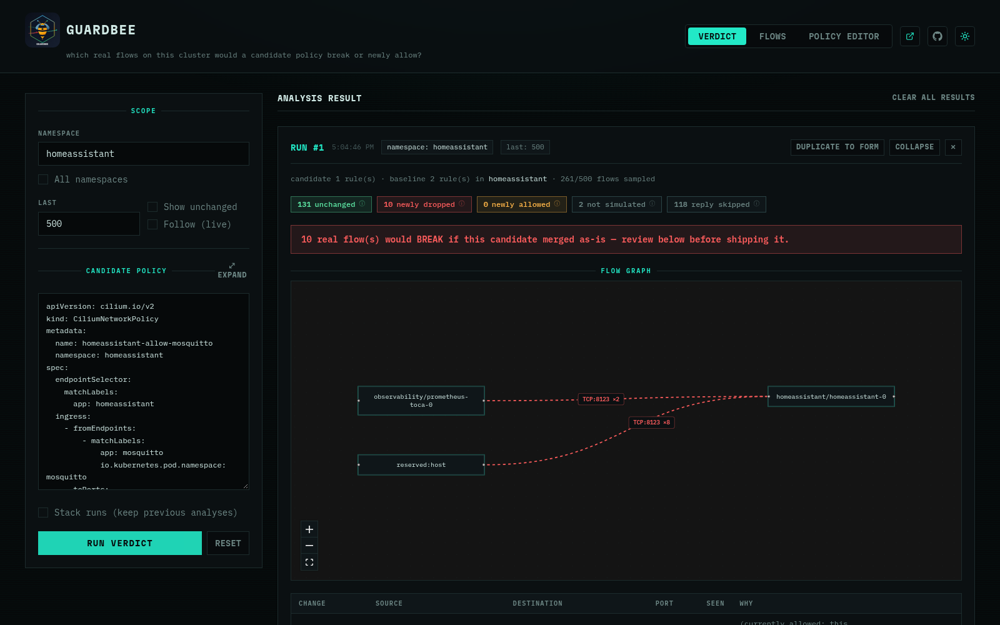
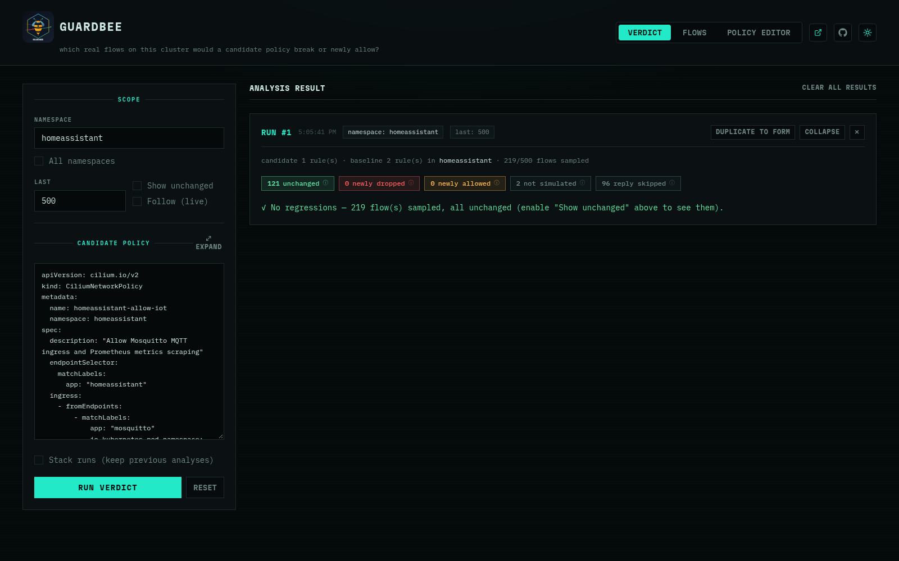

# How `verdict` works

Every sampled flow is judged twice — once against the real baseline
CNPs/CCNPs, once against baseline+candidate — using Cilium's own
`pkg/policy` engine (the same `.Parse()` conversion the real agent uses, not
a reimplementation). Flow identities come directly from Hubble's own
resolved `Endpoint.Identity`, so no separate `CiliumIdentity` lookup is
needed.

---

## Known v1 simplifications

Documented in code, not silent:

| Simplification | What it means |
|---|---|
| Ingress only | Only ingress-at-destination is evaluated — not full bidirectional ingress+egress correctness. |
| L7/FQDN flows | Counted as `not simulated` rather than guessed — those verdicts live in Envoy/the DNS proxy, not the policy map this engine computes. |
| Reply packets | Skipped (`reply (skipped)` in the summary) — connection tracking always allows those regardless of CNP ingress rules. |
| Real identities only | Candidate labels with no matching live pod are never exercised by any sampled flow — GuardBee never invents a fake identity. |
| `--last` is a ceiling | Hubble's flow buffer is a small recent-flow ring, not persisted history — it may hold fewer flows than requested. Use `--follow` to accumulate more over time instead of raising `--last` further. |

> A `0 newly dropped` result can mean "nothing in the sample touched the port
> you changed," not "nothing would break" — re-run, raise `--last`, or use
> `--follow` if a result looks too clean.

---

## Two regressions it caught

Both examples are real runs against the author's own homelab cluster — not
synthetic fixtures.

> A blank source/destination in the output (e.g. `reserved:host`) is a
> non-pod peer, not a bug — most commonly kubelet's TCP liveness/readiness
> probe.

### Scoped-too-narrow MQTT allow

`examples/homeassistant-allow-mosquitto.yaml` looks correct — it does
correctly keep real MQTT traffic working:

```
guardbee verdict -n homeassistant \
  examples/homeassistant-allow-mosquitto.yaml
```

But it would *also* silently break a Prometheus `:8123` scrape and
kubelet's health check on the same port — both confirmed via the
Kubernetes API, not guessed. `examples/homeassistant-merge-ready.yaml` is
the corrected version, re-run against the same cluster:

<p class="img-row">
  
  
</p>

> Left: looks correct, isn't. Right: same candidate, fixed — every real flow
> unchanged.

### Cluster-wide CoreDNS lockdown

The same lesson, one level up. `examples/ccnp-coredns-dns-only.yaml` is a
`CiliumClusterwideNetworkPolicy` that correctly restricts CoreDNS ingress to
DNS queries from any in-cluster pod:

```
guardbee verdict --all-namespaces --last 15000 \
  examples/ccnp-coredns-dns-only.yaml
```

It would *also* break kubelet's liveness/readiness probes and the
observability namespace's Prometheus scrape, across all CoreDNS pods.
`examples/ccnp-coredns-merge-ready.yaml` adds explicit rules for all three
and comes back with zero regressions on the same sample size.

> This one needs `--all-namespaces`, not a single namespace — the
> regression lives on the *source* side, which a namespace filter pinned to
> the destination's own namespace wouldn't rule out, and you may not know a
> CCNP's full blast radius in advance anyway.
