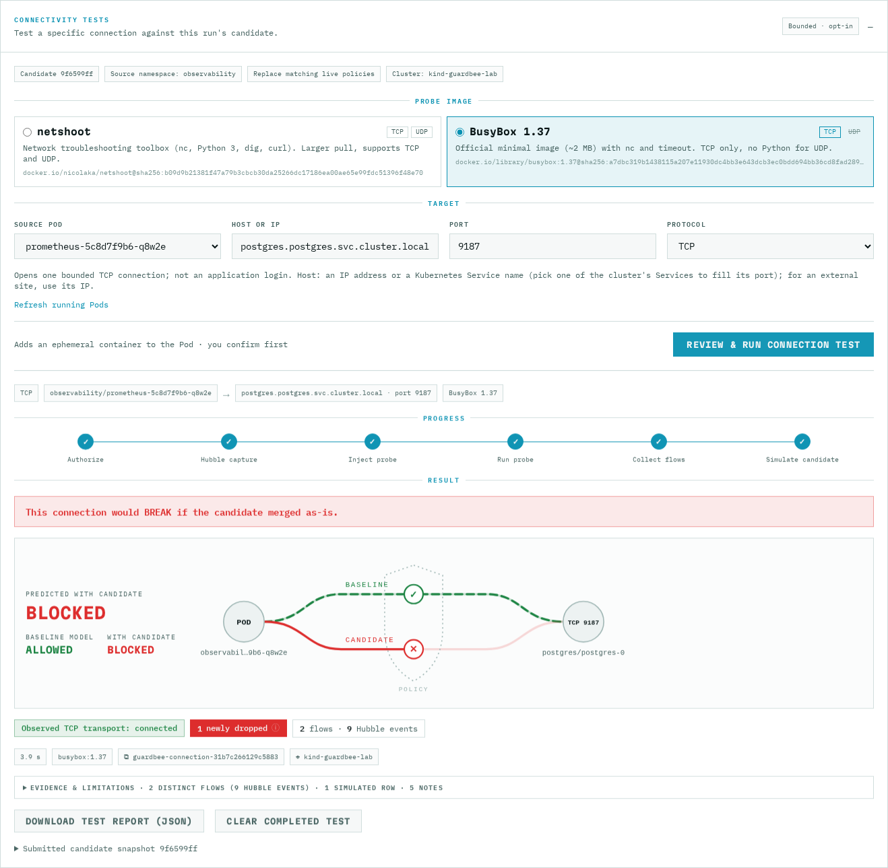

# Lab extras

Three deeper exercises on the same cluster, once you've finished the [Lab](lab.html)'s Steps 1–4. Each one stands on its own: do any of them, in any order.

| Exercise | What it shows |
|---|---|
| [1 — Connectivity test](#1--prove-one-connection-with-a-connectivity-test) | Prove one connection on demand, from a real Pod, against the candidate |
| [2 — L7 policies](#2--l7-policies-http-paths-and-dns-names) | HTTP paths and DNS names, judged request by request |
| [3 — `toFQDNs`](#3--tofqdns-names-that-arent-allowed-yet) | A DNS-name rule judged before Cilium has ever seen it |

> **Need the cluster back?** `mise run lab-up` from the repo root recreates it. See the [Lab's Step 1](lab.html#step-1--bring-the-lab-up).

---

## 1 — Prove one connection with a connectivity test

`verdict` predicts from traffic Hubble already saw. A connectivity test
makes one fresh connection from a real Pod and judges *that* against the
same candidate, which is handy when the flow you care about is rare (the
Prometheus scrape here runs far less often than `webapp`'s polling).

It's the one thing in this lab that changes the cluster: it appends a small
ephemeral container to the source Pod. That's fine on this throwaway lab.

```
guardbee ui --enable-probes
```

In **Verdict**, paste `lab/candidates/looks-correct.yaml` as the candidate,
tick **All namespaces** and **Run verdict**. Connectivity tests live in the
run's card and test that run's candidate, so expand **Connectivity tests**
there:

1. **Probe image** — pick **BusyBox 1.37**. It's one of the built-in vetted
   images, pinned by digest, and only does TCP, so UDP is greyed out.
2. Set **Source namespace** to `observability` and pick the
   `prometheus-…` Pod.
3. **Host or IP** `postgres.postgres.svc.cluster.local`, **Port** `9187`.
4. **Review & run connection test**, then confirm.

<div class="expect" markdown="1">
<div class="expect-titlebar"><span class="expect-dot red"></span><span class="expect-dot yellow"></span><span class="expect-dot green"></span><span class="expect-label">Expected result</span></div>
<div class="expect-body" markdown="1">

The stepper ticks through **Authorize → Hubble capture → Inject probe →
Run probe → Collect flows → Simulate candidate** as the server reports each
stage. Then the path diagram shows the **baseline** lane flowing through the
policy gate and the **candidate** lane stopped at it:

```
PREDICTED WITH CANDIDATE   BLOCKED
Baseline model  ALLOWED    With candidate  BLOCKED
Observed TCP transport: connected
```

<div class="shot">
<div class="shot-titlebar"><span class="shot-dot red"></span><span class="shot-dot yellow"></span><span class="shot-dot green"></span><span class="shot-label">guardbee ui · verdict — connectivity test</span></div>

</div>

The scrape the [Lab's Step 3](lab.html#step-3--run-verdict-against-the-looks-correct-candidate) verdict flagged, reproduced on demand: the connection
works today (no policy yet) and the candidate would cut it. Run the same
test from the `webapp` Pod to port `5432` and both lanes flow: **ALLOWED →
ALLOWED**. Then load `merge-ready.yaml` and re-run the 9187 test: the
candidate lane now flows too.

</div>
</div>

`mise run lab-validate` runs exactly these two tests (one per built-in
image) on a fresh lab, so the vetted images are re-checked against every
pinned Cilium. See [Connectivity tests](tcp-probes.html) for the image
catalog, `--probe-images-file`, and the safety model.

---

## 2 — L7 policies: HTTP paths and DNS names

So far every rule was L3/L4: who may talk to whom, on which port. Cilium can
also filter *requests*: HTTP method/path/headers through Envoy, DNS names
through its DNS proxy. `verdict` handles those in two ways:

- **Rules only.** Traffic that doesn't go through Cilium's proxy today has
  no request details in Hubble, so a candidate that adds L7 rules is
  reported as `L7_CHANGED`: still allowed at L4, but now checked against new
  request rules, which are shown.
- **Per request.** Once traffic does go through the proxy, Hubble records
  each HTTP request and DNS query, and `verdict` judges every one of them
  against the candidate's rules: a request the candidate would refuse is
  `NEWLY_DROPPED`, naming it.

### 2a — Adding an HTTP rule: rules compared

`examples/postgres-metrics-http-only.yaml` is the merge-ready policy, with the
Prometheus scrape narrowed to `GET /metrics`:

```
guardbee verdict -n postgres --fail-on-l7 examples/postgres-metrics-http-only.yaml
```

<div class="expect" markdown="1">
<div class="expect-titlebar"><span class="expect-dot red"></span><span class="expect-dot yellow"></span><span class="expect-dot green"></span><span class="expect-label">Expected output</span></div>
<div class="expect-body" markdown="1">

```
L7_CHANGED     observability/prometheus-… -> postgres/postgres-…  TCP:9187  (still allowed at L4; the L7 proxy's request rules for it change)  [L7 no L7 rules → ingress: HTTP GET /metrics]
```

Exit code `5` (`--fail-on-l7`): nothing breaks at L4, but the scrape is now
behind an HTTP rule.

</div>
</div>

### 2b — HTTP requests judged one by one

Apply that policy for real (this is a throwaway lab), so the scrape goes
through Envoy and Hubble records every request:

```
kubectl apply -f examples/postgres-metrics-http-only.yaml
```

Then judge two edits of it against those real requests. `--replace-existing`
compares against the live copy; the filters keep only the scrape's HTTP
records:

```
guardbee verdict -n postgres --replace-existing --type l7 \
  --from-label k8s:app=prometheus --to-port 9187 lab/l7/postgres-metrics-typo.yaml
guardbee verdict -n postgres --replace-existing --type l7 \
  --from-label k8s:app=prometheus --to-port 9187 lab/l7/postgres-metrics-any-subpath.yaml
```

<div class="expect" markdown="1">
<div class="expect-titlebar"><span class="expect-dot red"></span><span class="expect-dot yellow"></span><span class="expect-dot green"></span><span class="expect-label">Expected output</span></div>
<div class="expect-body" markdown="1">

```
NEWLY_DROPPED  observability/prometheus-… -> postgres/postgres-…  TCP:9187  (currently allowed; this candidate would start blocking it)  [L7 HTTP GET /metrics (matched by GuardBee, not Envoy); ingress: HTTP GET /metrics → ingress: HTTP GET /metric]
```

for the one-letter typo (`/metric`): Cilium's path rule is a regex that must
match the *whole* path, so every real scrape would get a 403. The looser
`/metrics.*` keeps every scrape: all unchanged.

</div>
</div>

"Matched by GuardBee, not Envoy": the rules are the exact ones Cilium sends
Envoy, but Envoy's matching is C++, so GuardBee evaluates them itself,
following Envoy's semantics (the path includes the query string, so
`/metrics` does not allow `/metrics?debug=1`). Applying the typo for real is
a quick way to see Envoy agree: `guardbee flows -n postgres --type l7`
shows the scrapes `DROPPED`.

### 2c — DNS queries judged one by one

`lab/l7/webapp-dns-live.yaml` sends webapp's DNS through Cilium's DNS proxy,
allowing any name. Apply it, then judge a candidate that narrows the names
to `*.cluster.local`:

```
kubectl apply -f lab/l7/webapp-dns-live.yaml
guardbee verdict -n webapp --replace-existing --type l7 --to-port 53 \
  examples/webapp-dns-single-label-wildcard.yaml
```

<div class="expect" markdown="1">
<div class="expect-titlebar"><span class="expect-dot red"></span><span class="expect-dot yellow"></span><span class="expect-dot green"></span><span class="expect-label">Expected output</span></div>
<div class="expect-body" markdown="1">

```
NEWLY_DROPPED  webapp/webapp-… -> kube-system/coredns-…  UDP:53  (currently allowed; this candidate would start blocking it)  [L7 DNS postgres.postgres.svc.cluster.local.; egress: DNS * → egress: DNS *.cluster.local]
```

webapp could no longer resolve its own database. In a Cilium `matchPattern`,
`*` matches **one** DNS label, so `*.cluster.local` doesn't match
`postgres.postgres.svc.cluster.local`; `**.cluster.local` (several labels) is
what was meant. Matching uses Cilium's own pattern code.

</div>
</div>

Clean up before moving on:

```
kubectl delete -f examples/postgres-metrics-http-only.yaml -f lab/l7/webapp-dns-live.yaml
```

`mise run lab-validate` runs 2a–2c on a fresh lab too (exit codes 5, 2, 0
and 2), so they're re-checked against every pinned Cilium.

---

## 3 — `toFQDNs`: names that aren't allowed yet

This one needs the kind cluster to reach the internet (DNS and HTTPS to
example.com).

A `toFQDNs` rule allows a DNS name, not an address. Cilium learns the
name's IPs from the DNS answers its DNS proxy sees, and labels each IP
`fqdn:<selector>`, but only for selectors already in a **live** policy. A
candidate's new name has no label yet, so `verdict` matches it against the
names Hubble recorded for each flow (its destination names), the same way
Cilium will once the policy is applied. Hubble records those names only
when the pod's DNS goes through the DNS proxy, so a live `rules.dns` rule
has to come first; the candidate's own doesn't count, because it hasn't
touched any traffic yet.

`lab/fqdn/fqdn-client-live.yaml` adds a small `fqdn-client` in `webapp` that
calls `https://example.com` every two seconds, with a live policy that sends
its DNS through the proxy and allows HTTPS to anywhere (`toEntities: world`),
with no `toFQDNs`:

```
kubectl apply -f lab/fqdn/fqdn-client-live.yaml
kubectl -n webapp rollout status deployment/fqdn-client
```

Check that Hubble knows the name. `--to-fqdn` matches the destination
names, so this shows flows only once the DNS proxy has seen the lookup:

```
guardbee flows -n webapp --from-label k8s:app=fqdn-client --to-fqdn example.com --last 10
```

Then replace the live policy with a `toFQDNs` one, first for the name the
client really calls, then for another one:

```
guardbee verdict -n webapp --replace-existing --fail-on-dropped \
  --from-label k8s:app=fqdn-client --to-port 443 lab/fqdn/fqdn-client-example-com.yaml
guardbee verdict -n webapp --replace-existing --fail-on-dropped \
  --from-label k8s:app=fqdn-client --to-port 443 lab/fqdn/fqdn-client-example-org.yaml
```

<div class="expect" markdown="1">
<div class="expect-titlebar"><span class="expect-dot red"></span><span class="expect-dot yellow"></span><span class="expect-dot green"></span><span class="expect-label">Expected output</span></div>
<div class="expect-body" markdown="1">

`example.com`: no changed rows, exit code `0`. The client keeps working,
even though no live policy has that selector yet.

`example.org`:

```
NEWLY_DROPPED  webapp/fqdn-client-… -> reserved:world (example.com)  TCP:443  (currently allowed; this candidate would start blocking it)
```

Exit code `2`: the client's HTTPS calls would be refused. The name in
parentheses is what Hubble recorded for that IP, the name the candidate
didn't match.

</div>
</div>

If the flows never carry names (DNS not behind the proxy, or the lookups
already gone from Hubble's buffer), a flow the candidate would drop is
counted as **not simulated** rather than reported as a drop, and
`--min-flows` doesn't count it. The names are the client pod's own lookups;
Cilium uses every pod's, so a pod connecting to an IP it never looked up
itself also reads as not simulated.

`examples/webapp-fqdn-without-dns-rule.yaml` shows the other mistake
`verdict` warns about: a `toFQDNs` with no `rules.dns` anywhere, which
Cilium accepts but which can never learn the name's IPs.

Clean up:

```
kubectl delete -f lab/fqdn/fqdn-client-live.yaml
```

`mise run lab-validate` runs this one too (exit codes `0` and `2`).

> **Want to build a policy from deny-all up instead?** Before tearing down the
> cluster, try the companion [Zero-trust walkthrough](zero-trust-walkthrough.html)
> (or watch it directly in [Videos → Zero-trust](videos.html#zero-trust)): it
> deploys a new `worker` Pod, locks down all ingress and egress, and
> accumulates allow rules one layer at a time using `NEWLY_ALLOWED` verdicts
> and live TCP/UDP connectivity tests.

---

## Done

```
mise run lab-down
```

Deletes the `guardbee-lab` kind cluster. Nothing else on your machine was touched.

| To | Read |
|---|---|
| Run the same checks against your own cluster | [Run on your cluster](run.html) |
| Fail pull requests that would break real traffic | [Gate PRs in CI](ci.html) |
| Build a least-privilege policy from default deny, layer by layer | [Zero-trust walkthrough](zero-trust-walkthrough.html) |
