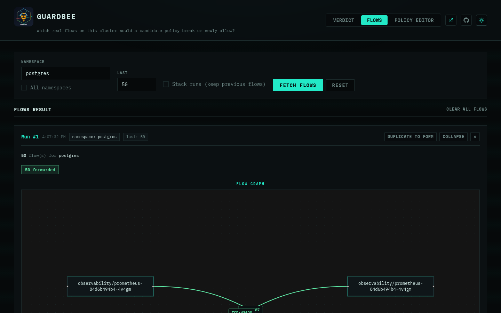
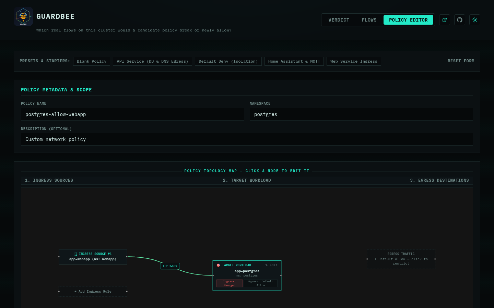
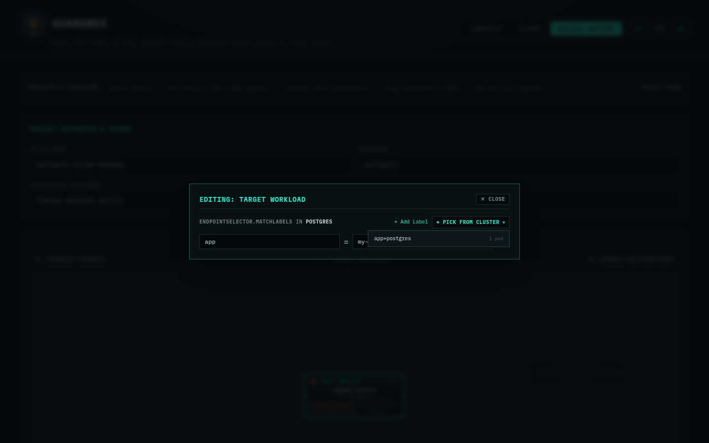
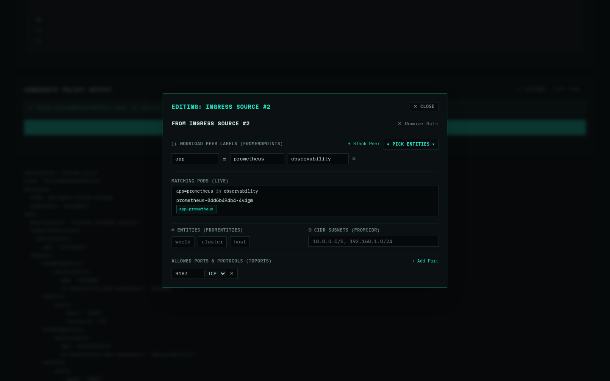

# Lab

Want to try it yourself? Follow this self-contained lab: a disposable
local kind cluster running Cilium, pre-loaded with a generic web-app/
Postgres/Prometheus scenario, so you can reproduce a real catch end to
end on your own laptop — nothing to match against someone else's
cluster. Every command below is copy-paste; every step says exactly what
you should see before moving to the next one.

## What you're about to break (on purpose)

| Role in the story | Workload |
|---|---|
| The database the candidate policy locks down | `postgres` (with a `postgres-exporter` sidecar) |
| The app it correctly allows | `webapp` → `postgres:5432` |
| The scrape it silently breaks | `prometheus` → the exporter's `:9187` |
| The probe it silently breaks | kubelet's own TCP health check → `:5432` |

Locking a database down to "just the app" and forgetting the exporter +
the probe is one of the most common real NetworkPolicy mistakes platform
teams make — this lab reproduces exactly that.

## Prerequisites

[mise](https://mise.jdx.dev), Docker,
[kind](https://kind.sigs.k8s.io/docs/user/quick-start/#installation),
[helm](https://helm.sh/docs/intro/install/), and `kubectl` already
installed and on your `PATH`. `lab-up` checks for the last four and
tells you what's missing — it never installs anything for you.

Then clone the repo and move into it — every command below assumes
you're running from inside this checkout:

```
git clone https://github.com/tchellomello/guardbee.git
cd guardbee
```

---

## Step 1 — Bring the lab up

```
mise run lab-up
```

Creates a kind cluster named `guardbee-lab`, installs Cilium
(`v1.20.2` — matching `go.mod`'s pinned version exactly) with Hubble and
Hubble Relay enabled, then deploys the three workloads above. Takes a
few minutes — most of it is Cilium's own images pulling and the agent
coming up.

<div class="expect" markdown="1">
<div class="expect-titlebar"><span class="expect-dot red"></span><span class="expect-dot yellow"></span><span class="expect-dot green"></span><span class="expect-label">Expected output</span></div>
<div class="expect-body" markdown="1">

```
guardbee lab: creating kind cluster "guardbee-lab"...
Creating cluster "guardbee-lab" ...
 ✓ Ensuring node image (kindest/node:v1.36.1)
 ✓ Preparing nodes
 ✓ Writing configuration
 ✓ Starting control-plane
 ✓ Installing StorageClass
 ✓ Joining worker nodes
Set kubectl context to "kind-guardbee-lab"

guardbee lab: installing Cilium 1.20.2 into cilium-system...
guardbee lab: waiting for Cilium and hubble-relay to report ready...
guardbee lab: deploying webapp / postgres / observability workloads...

guardbee lab is up. kubeconfig context: kind-guardbee-lab
```

</div>
</div>

> Missing Docker, kind, or helm? `lab-up` fails fast and names exactly
> what to install — it won't try to install anything for you.

<details markdown="1">
<summary>Hit a problem running <code>mise run lab-up</code>? (podman users)</summary>

**`could not find a log line that matches "...Multi-User System..."`**

Common if `docker` is aliased to podman (e.g. on NixOS) — kind's node
container runs its own nested systemd, and podman's default `journald`
log driver doesn't surface that back through `podman logs`, so kind's
own boot check times out even though the container booted fine. Fix,
bash/zsh:

```
CONTAINERS_CONF=<(printf \
    '[containers]\nlog_driver = "k8s-file"\n') \
  mise run lab-up
```

fish:

```
CONTAINERS_CONF=(printf \
    '[containers]\nlog_driver = "k8s-file"\n' | psub) \
  mise run lab-up
```

Or set `log_driver = "k8s-file"` under `[containers]` in your own
`containers.conf` permanently instead of passing it per-invocation.

**`/sys/fs/bpf: permission denied`, even after that**

A different, deeper issue: *rootless* podman's own privilege ceiling,
not the log driver. Cilium's agent needs to mount the BPF filesystem,
which a rootless container can't do no matter how `containers.conf` is
set. Check whether rootful podman is available:



```
sudo podman info --format '{{.Host.Security.Rootless}}'
```



`false` means yes — rerun the whole script with `sudo -E` (the `-E`
matters: plain `sudo` resets `$HOME` to `/root`, which would write the
kubeconfig there instead of your own `~/.kube/config`):

```
sudo -E env KIND_EXPERIMENTAL_PROVIDER=podman \
  CONTAINERS_CONF=<(printf \
      '[containers]\nlog_driver = "k8s-file"\n') \
  bash lab/scripts/lab-up.sh
```

fish:

```
sudo -E env KIND_EXPERIMENTAL_PROVIDER=podman \
  CONTAINERS_CONF=(printf \
      '[containers]\nlog_driver = "k8s-file"\n' | psub) \
  bash lab/scripts/lab-up.sh
```

</details>

---

## Step 2 — See real traffic, before touching any policy

```
guardbee flows -n postgres --last 50
```

<div class="expect" markdown="1">
<div class="expect-titlebar"><span class="expect-dot red"></span><span class="expect-dot yellow"></span><span class="expect-dot green"></span><span class="expect-label">Expected output</span></div>
<div class="expect-body" markdown="1">

Rows for all three kinds of real traffic already hitting `postgres`,
timestamps and pod-name suffixes aside (`--last 20` can miss the
Prometheus scrape — it's much less frequent than `webapp`'s polling —
`--last 50` reliably catches all three):

```
2026-10-14T20:02:54Z  FORWARDED  webapp/webapp-xxxxx
  -> postgres/postgres-xxxxx  TCP:5432
2026-10-14T20:02:54Z  FORWARDED  reserved:host
  -> postgres/postgres-xxxxx  TCP:5432
2026-10-14T20:02:54Z  FORWARDED  observability/prometheus-xxxxx
  -> postgres/postgres-xxxxx  TCP:9187
```

</div>
</div>

<div class="shot">
<div class="shot-titlebar"><span class="shot-dot red"></span><span class="shot-dot yellow"></span><span class="shot-dot green"></span><span class="shot-label">guardbee ui · flows</span></div>

</div>

Same traffic, in the UI's Flows tab (`guardbee ui`, `127.0.0.1:4747` by
default) — same engine, same cluster, just a graph instead of table rows.

This is the baseline — there's no CNP on `postgres` yet, so everything
is allowed. That's what the next step is about to change.

---

## Step 3 — Run `verdict` against the looks-correct candidate

> Prefer building the candidate visually instead of editing YAML? The
> Policy Editor's cluster-grounded picker pulls `app=postgres` straight
> from the live cluster, not a guess:
>
> <div class="img-row">
>   <div class="shot">
>   <div class="shot-titlebar"><span class="shot-dot red"></span><span class="shot-dot yellow"></span><span class="shot-dot green"></span><span class="shot-label">guardbee ui · policy editor</span></div>
>   
>   </div>
>   <div class="shot">
>   <div class="shot-titlebar"><span class="shot-dot red"></span><span class="shot-dot yellow"></span><span class="shot-dot green"></span><span class="shot-label">guardbee ui · pick from cluster</span></div>
>   
>   </div>
> </div>

```
guardbee verdict -n postgres --last 50 \
  lab/candidates/looks-correct.yaml
```

<div class="expect" markdown="1">
<div class="expect-titlebar"><span class="expect-dot red"></span><span class="expect-dot yellow"></span><span class="expect-dot green"></span><span class="expect-label">Expected output</span></div>
<div class="expect-body" markdown="1">

```
Judging 1 candidate rule(s) from looks-correct.yaml against 0
live rule(s) already in postgres, using 50 sampled flows.

NEWLY_DROPPED  observability/prometheus-xxxxx -> postgres/postgres-xxxxx
  TCP:9187  (currently allowed; this candidate would start blocking it)

NEWLY_DROPPED  reserved:host -> postgres/postgres-xxxxx
  TCP:5432  (currently allowed; this candidate would start blocking it)
  (seen 16x in this sample)

50 flows sampled: 15 unchanged, 17 newly dropped, 0 newly
allowed, 0 not simulated, 18 reply (skipped)

17 real flow(s) would BREAK if this candidate merged as-is —
review the NEWLY_DROPPED rows above before shipping it.
```

</div>
</div>

<div class="shot">
<div class="shot-titlebar"><span class="shot-dot red"></span><span class="shot-dot yellow"></span><span class="shot-dot green"></span><span class="shot-label">guardbee ui · verdict — looks-correct.yaml</span></div>

</div>

Same regression, in the UI — the two `NEWLY_DROPPED` rows and the red
dashed edges on the flow graph are the same verdict the CLI just gave
you.

Exact flow counts depend on your sample — the two `NEWLY_DROPPED` rows
are the part that won't change. The candidate looks completely
reasonable (it correctly allows `webapp`'s real traffic) and was never
applied to the cluster — `verdict` reads it as a plain file and
simulates it, so nothing above risked breaking anything real.

<details markdown="1">
<summary>Try it yourself: can you spot the fix before Step 4?</summary>

Before copying Step 4's command, try finding the fix yourself. Open
`guardbee ui`, go to the **Verdict** tab, and look at the flow graph
from the regression above — each red dashed edge points at exactly one
peer the candidate forgot, with the port it needs labeled right on the
edge. Two gaps, two peers. (Hint: one of them isn't a pod at all — look
at what it's named instead of `namespace/pod`.)

Here's the entire fix — the real diff between the two candidate files
in `lab/candidates/`:

```diff
--- looks-correct.yaml
+++ merge-ready.yaml
@@ -19,4 +19,18 @@
       toPorts:
         - ports:
             - port: "5432"
+              protocol: TCP
+    - fromEndpoints:
+        - matchLabels:
+            app: prometheus
+            io.kubernetes.pod.namespace: observability
+      toPorts:
+        - ports:
+            - port: "9187"
+              protocol: TCP
+    - fromEntities:
+        - host
+      toPorts:
+        - ports:
+            - port: "5432"
               protocol: TCP
```

That's a 1:1 map onto the UI: each `NEWLY_DROPPED` row's **+ Add to
Policy** button writes exactly one of these added blocks for you. Click
both, from Step 3's result, and you've produced `merge-ready.yaml`
without typing any YAML — same fix, same verdict, Step 4 just runs it
for you.

</details>

---

## Step 4 — Run `verdict` again against the fix

> Instead of hand-editing the merge-ready YAML, clicking **+ Add to
> Policy** on a `NEWLY_DROPPED` row from Step 3's UI result reopens the
> Policy Editor with that exact rule pre-filled — label, namespace, and
> port already matched from the live flow:
>
> <div class="shot">
> <div class="shot-titlebar"><span class="shot-dot red"></span><span class="shot-dot yellow"></span><span class="shot-dot green"></span><span class="shot-label">guardbee ui · policy editor — add to policy</span></div>
> 
> </div>

```
guardbee verdict -n postgres --last 50 \
  lab/candidates/merge-ready.yaml
```

<div class="expect" markdown="1">
<div class="expect-titlebar"><span class="expect-dot red"></span><span class="expect-dot yellow"></span><span class="expect-dot green"></span><span class="expect-label">Expected output</span></div>
<div class="expect-body" markdown="1">

```
Judging 1 candidate rule(s) from merge-ready.yaml against 0
live rule(s) already in postgres, using 50 sampled flows.

50 flows sampled: 31 unchanged, 0 newly dropped, 0 newly
allowed, 0 not simulated, 19 reply (skipped)
```

</div>
</div>

<div class="shot">
<div class="shot-titlebar"><span class="shot-dot red"></span><span class="shot-dot yellow"></span><span class="shot-dot green"></span><span class="shot-label">guardbee ui · verdict — merge-ready.yaml</span></div>

</div>

Same clean result in the UI — zero dropped, zero allowed, same "no
regressions" verdict the CLI just gave you.

Same candidate, corrected — it explicitly allows the exporter scrape and
the host probe alongside the app traffic. Zero `NEWLY_DROPPED`, zero
`NEWLY_ALLOWED`: safe to merge. See
[how verdict works](how-it-works.html) for what each of those counted
categories means.

---

## Step 5 — Tear down

```
mise run lab-down
```

Deletes the `guardbee-lab` kind cluster. Nothing else on your machine was
touched by any of the steps above.
