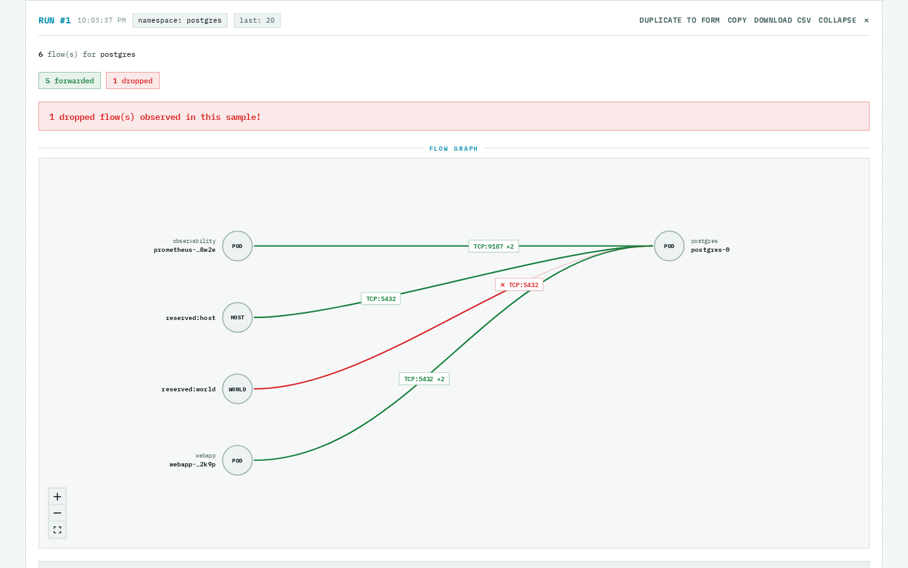
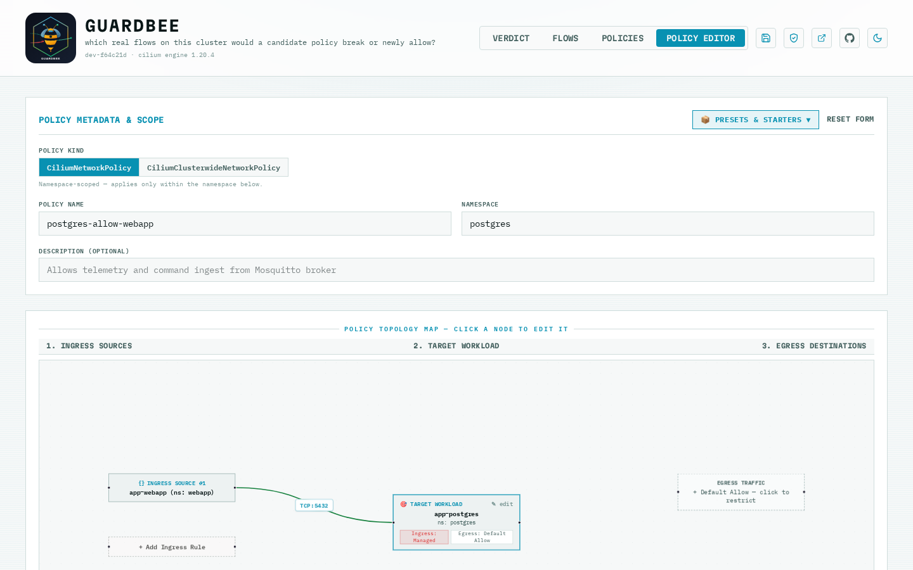
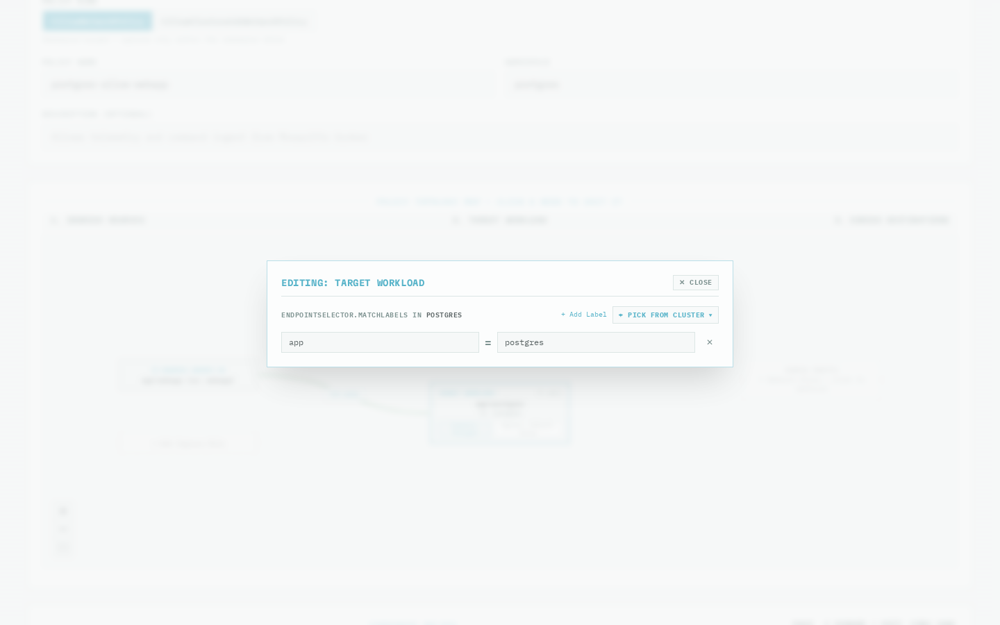
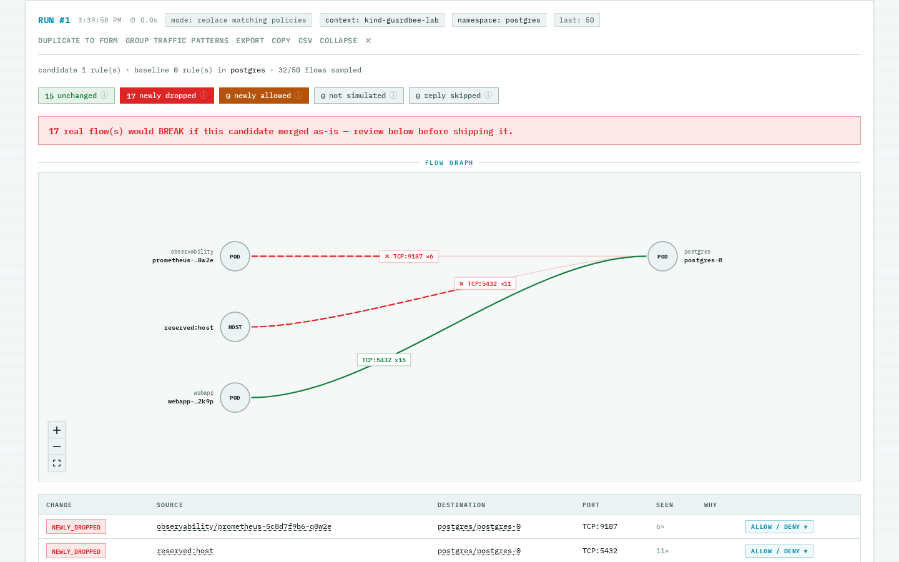
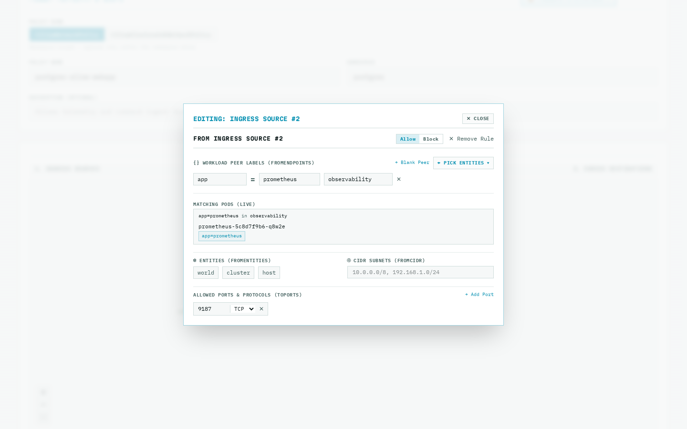
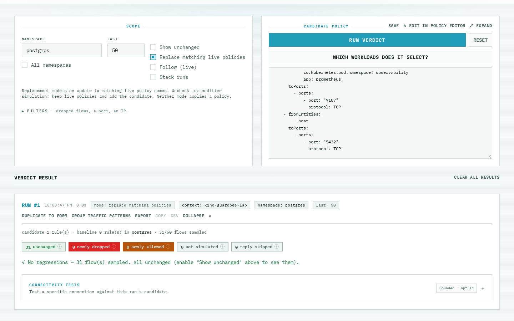
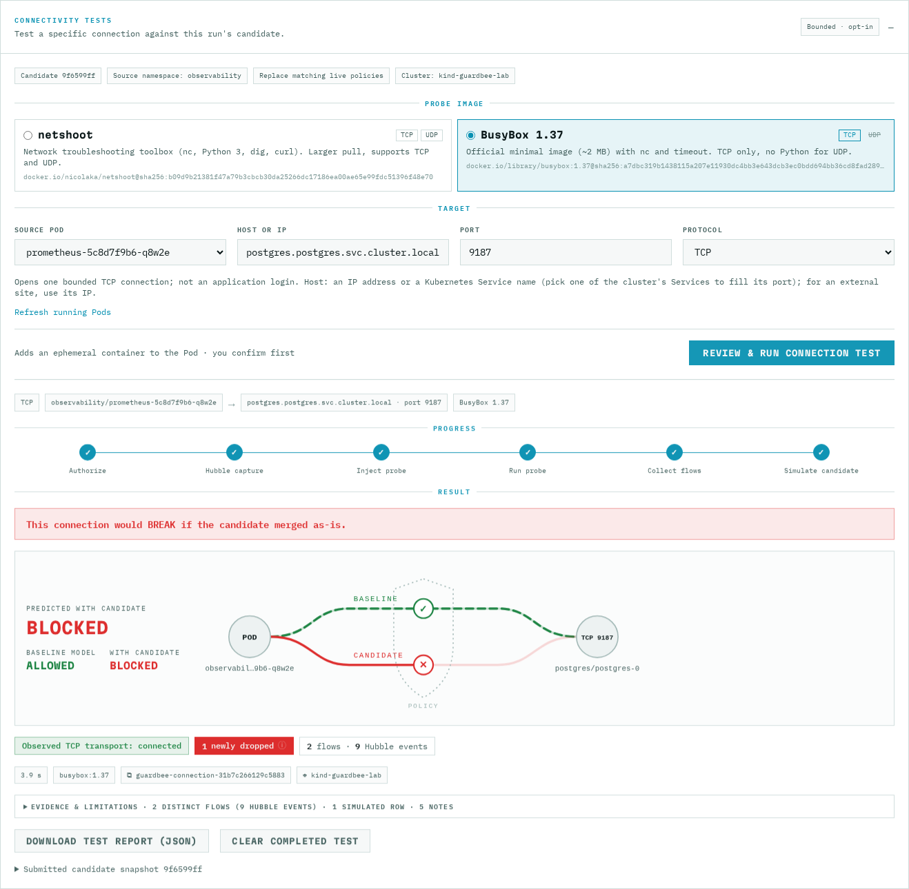

# Lab

Want to try it yourself? Follow this self-contained lab: a disposable
local kind cluster running Cilium, pre-loaded with a generic web-app/
Postgres/Prometheus scenario, so you can reproduce a real catch end to
end on your own laptop — nothing to match against someone else's
cluster. Every command below is copy-paste; every step says exactly what
you should see before moving to the next one.

## What you're about to break (on purpose)

| Role in the story | Workload |
|---|---|
| The database the candidate policy locks down | `postgres` (with a `postgres-exporter` sidecar) |
| The app it correctly allows | `webapp` → `postgres:5432` |
| The scrape it silently breaks | `prometheus` → the exporter's `:9187` |
| The probe it silently breaks | kubelet's own TCP health check → `:5432` |

Locking a database down to "just the app" and forgetting the exporter +
the probe is one of the most common real NetworkPolicy mistakes platform
teams make — this lab reproduces exactly that.

## Prerequisites

[mise](https://mise.jdx.dev), Docker,
[kind](https://kind.sigs.k8s.io/docs/user/quick-start/#installation),
[helm](https://helm.sh/docs/intro/install/), and `kubectl` already
installed and on your `PATH`. `lab-up` checks for the last four and
tells you what's missing — it never installs anything for you.

Then clone the repo and move into it — every command below assumes
you're running from inside this checkout:

```
git clone https://github.com/tchellomello/guardbee.git
cd guardbee
```

---

## Step 1 — Bring the lab up

```
mise run lab-up
```

Creates a kind cluster named `guardbee-lab`, installs Cilium
(`v1.20.4` — matching `go.mod`'s pinned version exactly) with Hubble and
Hubble Relay enabled, then deploys the three workloads above. Takes a
few minutes — most of it is Cilium's own images pulling and the agent
coming up.

<div class="expect" markdown="1">
<div class="expect-titlebar"><span class="expect-dot red"></span><span class="expect-dot yellow"></span><span class="expect-dot green"></span><span class="expect-label">Expected output</span></div>
<div class="expect-body" markdown="1">

```
guardbee lab: creating kind cluster "guardbee-lab"...
Creating cluster "guardbee-lab" ...
 ✓ Ensuring node image (kindest/node:v1.36.1)
 ✓ Preparing nodes
 ✓ Writing configuration
 ✓ Starting control-plane
 ✓ Installing StorageClass
 ✓ Joining worker nodes
Set kubectl context to "kind-guardbee-lab"

guardbee lab: installing Cilium 1.20.4 into cilium-system...
guardbee lab: waiting for Cilium and hubble-relay to report ready...
guardbee lab: deploying webapp / postgres / observability workloads...

guardbee lab is up. kubeconfig context: kind-guardbee-lab
```

</div>
</div>

> Missing Docker, kind, or helm? `lab-up` fails fast and names exactly
> what to install — it won't try to install anything for you.

<details markdown="1">
<summary>Hit a problem running <code>mise run lab-up</code>? (podman users)</summary>

**`could not find a log line that matches "...Multi-User System..."`**

Common if `docker` is aliased to podman (e.g. on NixOS) — kind's node
container runs its own nested systemd, and podman's default `journald`
log driver doesn't surface that back through `podman logs`, so kind's
own boot check times out even though the container booted fine. Fix,
bash/zsh:

```
CONTAINERS_CONF=<(printf \
    '[containers]\nlog_driver = "k8s-file"\n') \
  mise run lab-up
```

fish:

```
CONTAINERS_CONF=(printf \
    '[containers]\nlog_driver = "k8s-file"\n' | psub) \
  mise run lab-up
```

Or set `log_driver = "k8s-file"` under `[containers]` in your own
`containers.conf` permanently instead of passing it per-invocation.

**`/sys/fs/bpf: permission denied`, even after that**

A different, deeper issue: *rootless* podman's own privilege ceiling,
not the log driver. Cilium's agent needs to mount the BPF filesystem,
which a rootless container can't do no matter how `containers.conf` is
set. Check whether rootful podman is available:



```
sudo podman info --format '{{.Host.Security.Rootless}}'
```



`false` means yes — rerun the whole script with `sudo -E` (the `-E`
matters: plain `sudo` resets `$HOME` to `/root`, which would write the
kubeconfig there instead of your own `~/.kube/config`):

```
sudo -E env KIND_EXPERIMENTAL_PROVIDER=podman \
  CONTAINERS_CONF=<(printf \
      '[containers]\nlog_driver = "k8s-file"\n') \
  bash lab/scripts/lab-up.sh
```

fish:

```
sudo -E env KIND_EXPERIMENTAL_PROVIDER=podman \
  CONTAINERS_CONF=(printf \
      '[containers]\nlog_driver = "k8s-file"\n' | psub) \
  bash lab/scripts/lab-up.sh
```

</details>

---

## Step 2 — See real traffic, before touching any policy

```
guardbee flows -n postgres --last 50
```

<div class="expect" markdown="1">
<div class="expect-titlebar"><span class="expect-dot red"></span><span class="expect-dot yellow"></span><span class="expect-dot green"></span><span class="expect-label">Expected output</span></div>
<div class="expect-body" markdown="1">

Rows for all three kinds of real traffic already hitting `postgres`,
timestamps and pod-name suffixes aside (`--last 20` can miss the
Prometheus scrape — it's much less frequent than `webapp`'s polling —
`--last 50` reliably catches all three):

```
2026-10-14T20:02:54Z  FORWARDED  webapp/webapp-xxxxx
  -> postgres/postgres-xxxxx  TCP:5432
2026-10-14T20:02:54Z  FORWARDED  reserved:host
  -> postgres/postgres-xxxxx  TCP:5432
2026-10-14T20:02:54Z  FORWARDED  observability/prometheus-xxxxx
  -> postgres/postgres-xxxxx  TCP:9187
```

</div>
</div>

<div class="shot">
<div class="shot-titlebar"><span class="shot-dot red"></span><span class="shot-dot yellow"></span><span class="shot-dot green"></span><span class="shot-label">guardbee ui · flows</span></div>

</div>

Same traffic, in the UI's Flows tab (`guardbee ui`, `127.0.0.1:4747` by
default) — same engine, same cluster, just a graph instead of table rows.

This is the baseline — there's no CNP on `postgres` yet, so everything
is allowed. That's what the next step is about to change.

---

## Step 3 — Run `verdict` against the looks-correct candidate

> Prefer building the candidate visually instead of editing YAML? The
> Policy Editor's cluster-grounded picker pulls `app=postgres` straight
> from the live cluster, not a guess:
>
> <div class="img-row">
>   <div class="shot">
>   <div class="shot-titlebar"><span class="shot-dot red"></span><span class="shot-dot yellow"></span><span class="shot-dot green"></span><span class="shot-label">guardbee ui · policy editor</span></div>
>   
>   </div>
>   <div class="shot">
>   <div class="shot-titlebar"><span class="shot-dot red"></span><span class="shot-dot yellow"></span><span class="shot-dot green"></span><span class="shot-label">guardbee ui · pick from cluster</span></div>
>   
>   </div>
> </div>

```
guardbee verdict -n postgres --last 50 \
  lab/candidates/looks-correct.yaml
```

<div class="expect" markdown="1">
<div class="expect-titlebar"><span class="expect-dot red"></span><span class="expect-dot yellow"></span><span class="expect-dot green"></span><span class="expect-label">Expected output</span></div>
<div class="expect-body" markdown="1">

```
Judging 1 candidate rule(s) from looks-correct.yaml against 0
live rule(s) already in postgres, using 50 sampled flows.

NEWLY_DROPPED  observability/prometheus-xxxxx -> postgres/postgres-xxxxx
  TCP:9187  (currently allowed; this candidate would start blocking it)

NEWLY_DROPPED  reserved:host -> postgres/postgres-xxxxx
  TCP:5432  (currently allowed; this candidate would start blocking it)
  (seen 16x in this sample)

50 flows sampled: 15 unchanged, 17 newly dropped, 0 newly
allowed, 0 not simulated, 18 reply (skipped)

17 real flow(s) would BREAK if this candidate merged as-is —
review the NEWLY_DROPPED rows above before shipping it.
```

</div>
</div>

<div class="shot">
<div class="shot-titlebar"><span class="shot-dot red"></span><span class="shot-dot yellow"></span><span class="shot-dot green"></span><span class="shot-label">guardbee ui · verdict — looks-correct.yaml</span></div>

</div>

Same regression, in the UI — the two `NEWLY_DROPPED` rows and the red
dashed edges on the flow graph are the same verdict the CLI just gave
you.

Exact flow counts depend on your sample — the two `NEWLY_DROPPED` rows
are the part that won't change. The candidate looks completely
reasonable (it correctly allows `webapp`'s real traffic) and was never
applied to the cluster — `verdict` reads it as a plain file and
simulates it, so nothing above risked breaking anything real.

<details markdown="1">
<summary>Try it yourself: can you spot the fix before Step 4?</summary>

Before copying Step 4's command, try finding the fix yourself. Open
`guardbee ui`, go to the **Verdict** tab, and look at the flow graph
from the regression above — each red dashed edge points at exactly one
peer the candidate forgot, with the port it needs labeled right on the
edge. Two gaps, two peers. (Hint: one of them isn't a pod at all — look
at what it's named instead of `namespace/pod`.)

Here's the entire fix — the real diff between the two candidate files
in `lab/candidates/`:

```diff
--- looks-correct.yaml
+++ merge-ready.yaml
@@ -19,4 +19,18 @@
       toPorts:
         - ports:
             - port: "5432"
+              protocol: TCP
+    - fromEndpoints:
+        - matchLabels:
+            app: prometheus
+            io.kubernetes.pod.namespace: observability
+      toPorts:
+        - ports:
+            - port: "9187"
+              protocol: TCP
+    - fromEntities:
+        - host
+      toPorts:
+        - ports:
+            - port: "5432"
               protocol: TCP
```

That's a 1:1 map onto the UI: each `NEWLY_DROPPED` row's **+ Add to
Policy** button writes exactly one of these added blocks for you. Click
both, from Step 3's result, and you've produced `merge-ready.yaml`
without typing any YAML — same fix, same verdict, Step 4 just runs it
for you.

</details>

---

## Step 4 — Run `verdict` again against the fix

> Instead of hand-editing the merge-ready YAML, clicking **+ Add to
> Policy** on a `NEWLY_DROPPED` row from Step 3's UI result reopens the
> Policy Editor with that exact rule pre-filled — label, namespace, and
> port already matched from the live flow:
>
> <div class="shot">
> <div class="shot-titlebar"><span class="shot-dot red"></span><span class="shot-dot yellow"></span><span class="shot-dot green"></span><span class="shot-label">guardbee ui · policy editor — add to policy</span></div>
> 
> </div>

```
guardbee verdict -n postgres --last 50 \
  lab/candidates/merge-ready.yaml
```

<div class="expect" markdown="1">
<div class="expect-titlebar"><span class="expect-dot red"></span><span class="expect-dot yellow"></span><span class="expect-dot green"></span><span class="expect-label">Expected output</span></div>
<div class="expect-body" markdown="1">

```
Judging 1 candidate rule(s) from merge-ready.yaml against 0
live rule(s) already in postgres, using 50 sampled flows.

50 flows sampled: 31 unchanged, 0 newly dropped, 0 newly
allowed, 0 not simulated, 19 reply (skipped)
```

</div>
</div>

<div class="shot">
<div class="shot-titlebar"><span class="shot-dot red"></span><span class="shot-dot yellow"></span><span class="shot-dot green"></span><span class="shot-label">guardbee ui · verdict — merge-ready.yaml</span></div>

</div>

Same clean result in the UI — zero dropped, zero allowed, same "no
regressions" verdict the CLI just gave you.

Same candidate, corrected — it explicitly allows the exporter scrape and
the host probe alongside the app traffic. Zero `NEWLY_DROPPED`, zero
`NEWLY_ALLOWED`: safe to merge. See
[how verdict works](how-it-works.html) for what each of those counted
categories means.

---

## Step 5 — Prove one connection with a connectivity test (optional)

`verdict` predicts from traffic Hubble already saw. A connectivity test
makes one fresh connection from a real Pod and judges *that* against the
same candidate, which is handy when the flow you care about is rare (the
Prometheus scrape here runs far less often than `webapp`'s polling).

It's the one thing in this lab that changes the cluster: it appends a small
ephemeral container to the source Pod. That's fine on this throwaway lab.

```
guardbee ui --enable-probes
```

In **Verdict**, paste `lab/candidates/looks-correct.yaml` as the candidate,
tick **All namespaces** and **Run verdict**. Connectivity tests live in the
run's card and test that run's candidate, so expand **Connectivity tests**
there:

1. **Probe image** — pick **BusyBox 1.37**. It's one of the built-in vetted
   images, pinned by digest, and only does TCP, so UDP is greyed out.
2. Set **Source namespace** to `observability` and pick the
   `prometheus-…` Pod.
3. **Host or IP** `postgres.postgres.svc.cluster.local`, **Port** `9187`.
4. **Review & run connection test**, then confirm.

<div class="expect" markdown="1">
<div class="expect-titlebar"><span class="expect-dot red"></span><span class="expect-dot yellow"></span><span class="expect-dot green"></span><span class="expect-label">Expected result</span></div>
<div class="expect-body" markdown="1">

The stepper ticks through **Authorize → Hubble capture → Inject probe →
Run probe → Collect flows → Simulate candidate** as the server reports each
stage. Then the path diagram shows the **baseline** lane flowing through the
policy gate and the **candidate** lane stopped at it:

```
PREDICTED WITH CANDIDATE   BLOCKED
Baseline model  ALLOWED    With candidate  BLOCKED
Observed TCP transport: connected
```

<div class="shot">
<div class="shot-titlebar"><span class="shot-dot red"></span><span class="shot-dot yellow"></span><span class="shot-dot green"></span><span class="shot-label">guardbee ui · verdict — connectivity test</span></div>

</div>

The scrape the Step 3 verdict flagged, reproduced on demand: the connection
works today (no policy yet) and the candidate would cut it. Run the same
test from the `webapp` Pod to port `5432` and both lanes flow: **ALLOWED →
ALLOWED**. Then load `merge-ready.yaml` and re-run the 9187 test: the
candidate lane now flows too.

</div>
</div>

`mise run lab-validate` runs exactly these two tests (one per built-in
image) on a fresh lab, so the vetted images are re-checked against every
pinned Cilium. See [Connectivity tests](tcp-probes.html) for the image
catalog, `--probe-images-file`, and the safety model.

---

## Step 6 — L7 policies: HTTP paths and DNS names (optional)

So far every rule was L3/L4: who may talk to whom, on which port. Cilium can
also filter *requests*: HTTP method/path/headers through Envoy, DNS names
through its DNS proxy. `verdict` handles those in two ways:

- **Rules only.** Traffic that doesn't go through Cilium's proxy today has
  no request details in Hubble, so a candidate that adds L7 rules is
  reported as `L7_CHANGED`: still allowed at L4, but now checked against new
  request rules, which are shown.
- **Per request.** Once traffic does go through the proxy, Hubble records
  each HTTP request and DNS query, and `verdict` judges every one of them
  against the candidate's rules: a request the candidate would refuse is
  `NEWLY_DROPPED`, naming it.

### 6a — Adding an HTTP rule: rules compared

`examples/postgres-metrics-http-only.yaml` is the merge-ready policy, with the
Prometheus scrape narrowed to `GET /metrics`:

```
guardbee verdict -n postgres --fail-on-l7 examples/postgres-metrics-http-only.yaml
```

<div class="expect" markdown="1">
<div class="expect-titlebar"><span class="expect-dot red"></span><span class="expect-dot yellow"></span><span class="expect-dot green"></span><span class="expect-label">Expected output</span></div>
<div class="expect-body" markdown="1">

```
L7_CHANGED     observability/prometheus-… -> postgres/postgres-…  TCP:9187  (still allowed at L4; the L7 proxy's request rules for it change)  [L7 no L7 rules → ingress: HTTP GET /metrics]
```

Exit code `5` (`--fail-on-l7`): nothing breaks at L4, but the scrape is now
behind an HTTP rule.

</div>
</div>

### 6b — HTTP requests judged one by one

Apply that policy for real (this is a throwaway lab), so the scrape goes
through Envoy and Hubble records every request:

```
kubectl apply -f examples/postgres-metrics-http-only.yaml
```

Then judge two edits of it against those real requests. `--replace-existing`
compares against the live copy; the filters keep only the scrape's HTTP
records:

```
guardbee verdict -n postgres --replace-existing --type l7 \
  --from-label k8s:app=prometheus --to-port 9187 lab/l7/postgres-metrics-typo.yaml
guardbee verdict -n postgres --replace-existing --type l7 \
  --from-label k8s:app=prometheus --to-port 9187 lab/l7/postgres-metrics-any-subpath.yaml
```

<div class="expect" markdown="1">
<div class="expect-titlebar"><span class="expect-dot red"></span><span class="expect-dot yellow"></span><span class="expect-dot green"></span><span class="expect-label">Expected output</span></div>
<div class="expect-body" markdown="1">

```
NEWLY_DROPPED  observability/prometheus-… -> postgres/postgres-…  TCP:9187  (currently allowed; this candidate would start blocking it)  [L7 HTTP GET /metrics (matched by GuardBee, not Envoy); ingress: HTTP GET /metrics → ingress: HTTP GET /metric]
```

for the one-letter typo (`/metric`): Cilium's path rule is a regex that must
match the *whole* path, so every real scrape would get a 403. The looser
`/metrics.*` keeps every scrape: all unchanged.

</div>
</div>

"Matched by GuardBee, not Envoy": the rules are the exact ones Cilium sends
Envoy, but Envoy's matching is C++, so GuardBee evaluates them itself,
following Envoy's semantics (the path includes the query string, so
`/metrics` does not allow `/metrics?debug=1`). Applying the typo for real is
a quick way to see Envoy agree: `guardbee flows -n postgres --type l7`
shows the scrapes `DROPPED`.

### 6c — DNS queries judged one by one

`lab/l7/webapp-dns-live.yaml` sends webapp's DNS through Cilium's DNS proxy,
allowing any name. Apply it, then judge a candidate that narrows the names
to `*.cluster.local`:

```
kubectl apply -f lab/l7/webapp-dns-live.yaml
guardbee verdict -n webapp --replace-existing --type l7 --to-port 53 \
  examples/webapp-dns-single-label-wildcard.yaml
```

<div class="expect" markdown="1">
<div class="expect-titlebar"><span class="expect-dot red"></span><span class="expect-dot yellow"></span><span class="expect-dot green"></span><span class="expect-label">Expected output</span></div>
<div class="expect-body" markdown="1">

```
NEWLY_DROPPED  webapp/webapp-… -> kube-system/coredns-…  UDP:53  (currently allowed; this candidate would start blocking it)  [L7 DNS postgres.postgres.svc.cluster.local.; egress: DNS * → egress: DNS *.cluster.local]
```

webapp could no longer resolve its own database. In a Cilium `matchPattern`,
`*` matches **one** DNS label, so `*.cluster.local` doesn't match
`postgres.postgres.svc.cluster.local`; `**.cluster.local` (several labels) is
what was meant. Matching uses Cilium's own pattern code.

</div>
</div>

Clean up before moving on:

```
kubectl delete -f examples/postgres-metrics-http-only.yaml -f lab/l7/webapp-dns-live.yaml
```

`mise run lab-validate` runs 6a–6c on a fresh lab too (exit codes 5, 2, 0
and 2), so they're re-checked against every pinned Cilium.

---

## Step 7 — `toFQDNs`: names that aren't allowed yet (optional)

This step needs the kind cluster to reach the internet (DNS and HTTPS to
example.com).

A `toFQDNs` rule allows a DNS name, not an address. Cilium learns the
name's IPs from the DNS answers its DNS proxy sees, and labels each IP
`fqdn:<selector>`, but only for selectors already in a **live** policy. A
candidate's new name has no label yet, so `verdict` matches it against the
names Hubble recorded for each flow (its destination names), the same way
Cilium will once the policy is applied. Hubble records those names only
when the pod's DNS goes through the DNS proxy, so a live `rules.dns` rule
has to come first; the candidate's own doesn't count, because it hasn't
touched any traffic yet.

`lab/fqdn/fqdn-client-live.yaml` adds a small `fqdn-client` in `webapp` that
calls `https://example.com` every two seconds, with a live policy that sends
its DNS through the proxy and allows HTTPS to anywhere (`toEntities: world`),
with no `toFQDNs`:

```
kubectl apply -f lab/fqdn/fqdn-client-live.yaml
kubectl -n webapp rollout status deployment/fqdn-client
```

Check that Hubble knows the name. `--to-fqdn` matches the destination
names, so this shows flows only once the DNS proxy has seen the lookup:

```
guardbee flows -n webapp --from-label k8s:app=fqdn-client --to-fqdn example.com --last 10
```

Then replace the live policy with a `toFQDNs` one, first for the name the
client really calls, then for another one:

```
guardbee verdict -n webapp --replace-existing --fail-on-dropped \
  --from-label k8s:app=fqdn-client --to-port 443 lab/fqdn/fqdn-client-example-com.yaml
guardbee verdict -n webapp --replace-existing --fail-on-dropped \
  --from-label k8s:app=fqdn-client --to-port 443 lab/fqdn/fqdn-client-example-org.yaml
```

<div class="expect" markdown="1">
<div class="expect-titlebar"><span class="expect-dot red"></span><span class="expect-dot yellow"></span><span class="expect-dot green"></span><span class="expect-label">Expected output</span></div>
<div class="expect-body" markdown="1">

`example.com`: no changed rows, exit code `0`. The client keeps working,
even though no live policy has that selector yet.

`example.org`:

```
NEWLY_DROPPED  webapp/fqdn-client-… -> reserved:world (example.com)  TCP:443  (currently allowed; this candidate would start blocking it)
```

Exit code `2`: the client's HTTPS calls would be refused. The name in
parentheses is what Hubble recorded for that IP, the name the candidate
didn't match.

</div>
</div>

If the flows never carry names (DNS not behind the proxy, or the lookups
already gone from Hubble's buffer), a flow the candidate would drop is
counted as **not simulated** rather than reported as a drop, and
`--min-flows` doesn't count it. The names are the client pod's own lookups;
Cilium uses every pod's, so a pod connecting to an IP it never looked up
itself also reads as not simulated.

`examples/webapp-fqdn-without-dns-rule.yaml` shows the other mistake
`verdict` warns about: a `toFQDNs` with no `rules.dns` anywhere, which
Cilium accepts but which can never learn the name's IPs.

Clean up:

```
kubectl delete -f lab/fqdn/fqdn-client-live.yaml
```

`mise run lab-validate` runs this step too (exit codes `0` and `2`).

> **Want to build a policy from deny-all up instead?** Before tearing down the
> cluster, try the companion [Zero-trust walkthrough](zero-trust-walkthrough.html)
> (or watch it directly in [Videos → Zero-trust](videos.html#zero-trust)): it
> deploys a new `worker` Pod, locks down all ingress and egress, and
> accumulates allow rules one layer at a time using `NEWLY_ALLOWED` verdicts
> and live TCP/UDP connectivity tests.

---

## Step 8 — Tear down

```
mise run lab-down
```

Deletes the `guardbee-lab` kind cluster. Nothing else on your machine was
touched by any of the steps above.

---

## Next

| To | Read |
|---|---|
| Run the same checks against your own cluster | [Run on your cluster](run.html) |
| Fail pull requests that would break real traffic | [Gate PRs in CI](ci.html) |
| Build a least-privilege policy from default deny, layer by layer | [Zero-trust walkthrough](zero-trust-walkthrough.html) |
