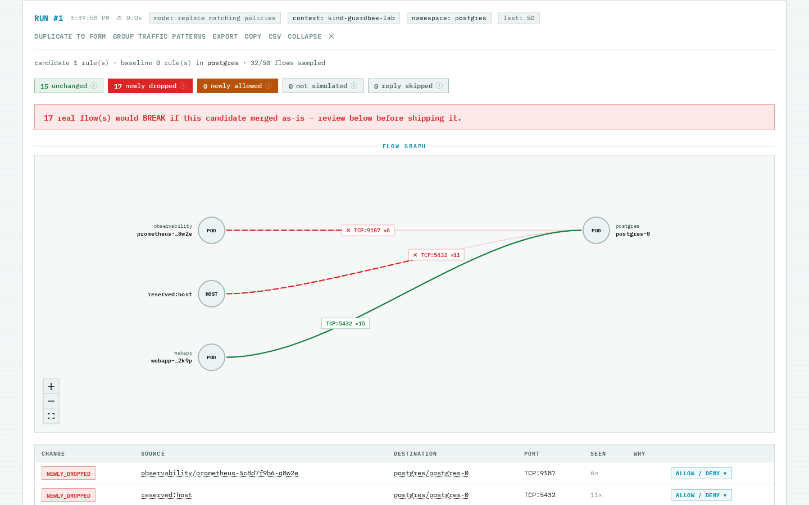
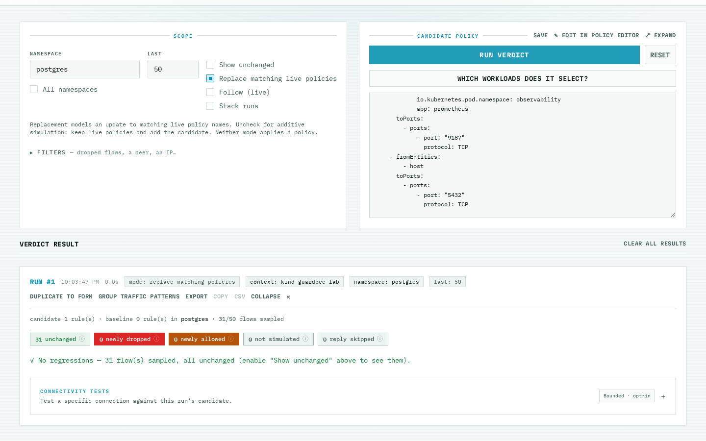

# Quickstart

Watch GuardBee catch a policy that looks right and isn't, on a disposable local cluster. About ten minutes, most of it Cilium starting up. No cluster of your own needed.

<div class="demo-player" data-anchor="quickstart-video">
  <div class="demo-player-bar">
    <span class="demo-player-dot"></span>
    <span class="demo-player-dot"></span>
    <span class="demo-player-dot"></span>
    <span class="demo-player-title">guardbee-demo · full lab walkthrough</span>
  </div>
  <video class="demo-video" controls playsinline preload="metadata" poster="../assets/guardbee-demo-poster.png">
    <source src="https://github.com/tchellomello/guardbee/releases/download/docs-media/guardbee-demo.mp4" type="video/mp4">
    <source src="https://github.com/tchellomello/guardbee/releases/download/docs-media/guardbee-demo.webm" type="video/webm">
    Your browser does not support the video tag.
  </video>
</div>

**You need:** [GuardBee installed](install.html), plus [mise](https://mise.jdx.dev), Docker, [kind](https://kind.sigs.k8s.io/docs/user/quick-start/#installation), [helm](https://helm.sh/docs/intro/install/) and `kubectl` on your `PATH`.

---

## 1. Start the lab cluster

```
git clone https://github.com/tchellomello/guardbee.git
cd guardbee
mise run lab-up
```

A kind cluster with Cilium and Hubble Relay, running three workloads: `webapp` talks to `postgres`, and `prometheus` scrapes postgres's metrics exporter. The kubelet health-checks postgres too.

---

## 2. Judge a policy that looks correct

This candidate locks postgres down to "just the app". It was never applied; GuardBee reads it as a file:

```
guardbee verdict -n postgres --last 50 lab/candidates/looks-correct.yaml
```

<div class="expect" markdown="1">
<div class="expect-titlebar"><span class="expect-dot red"></span><span class="expect-dot yellow"></span><span class="expect-dot green"></span><span class="expect-label">Expected output</span></div>
<div class="expect-body" markdown="1">

```
Judging 1 candidate rule(s) from looks-correct.yaml against 0
live rule(s) already in postgres, using 50 sampled flows.

NEWLY_DROPPED  observability/prometheus-xxxxx -> postgres/postgres-xxxxx
  TCP:9187  (currently allowed; this candidate would start blocking it)

NEWLY_DROPPED  reserved:host -> postgres/postgres-xxxxx
  TCP:5432  (currently allowed; this candidate would start blocking it)
  (seen 16x in this sample)

50 flows sampled: 15 unchanged, 17 newly dropped, 0 newly
allowed, 0 not simulated, 18 reply (skipped)

17 real flow(s) would BREAK if this candidate merged as-is —
review the NEWLY_DROPPED rows above before shipping it.
```

</div>
</div>

It allows `webapp`, and silently breaks the Prometheus scrape and the kubelet's health probe (`reserved:host`). Exact counts depend on your sample; the two rows don't.

---

## 3. Judge the fix

```
guardbee verdict -n postgres --last 50 lab/candidates/merge-ready.yaml
```

<div class="expect" markdown="1">
<div class="expect-titlebar"><span class="expect-dot red"></span><span class="expect-dot yellow"></span><span class="expect-dot green"></span><span class="expect-label">Expected output</span></div>
<div class="expect-body" markdown="1">

```
Judging 1 candidate rule(s) from merge-ready.yaml against 0
live rule(s) already in postgres, using 50 sampled flows.

50 flows sampled: 31 unchanged, 0 newly dropped, 0 newly
allowed, 0 not simulated, 19 reply (skipped)
```

</div>
</div>

---

## 4. See it in the browser

```
guardbee ui
```

Open `http://127.0.0.1:4747`, go to **Verdict**, and run the same two candidates. The broken flows are red dashed edges on the graph, and **+ Add to Policy** on a `NEWLY_DROPPED` row writes the missing rule for you.

<div class="img-row">
<div class="shot">
<div class="shot-titlebar"><span class="shot-dot red"></span><span class="shot-dot yellow"></span><span class="shot-dot green"></span><span class="shot-label">before — looks-correct.yaml</span></div>

</div>
<div class="shot">
<div class="shot-titlebar"><span class="shot-dot red"></span><span class="shot-dot yellow"></span><span class="shot-dot green"></span><span class="shot-label">after — merge-ready.yaml</span></div>

</div>
</div>

When you're done, `mise run lab-down` deletes the cluster. Nothing else on your machine was touched.

---

## Next

| To | Read |
|---|---|
| Go deeper on the same cluster: L7 rules, `toFQDNs`, connectivity tests | [Lab](lab.html) |
| Run it against your own cluster | [Run on your cluster](run.html) |
| Fail pull requests that would break real traffic | [Gate PRs in CI](ci.html) |
