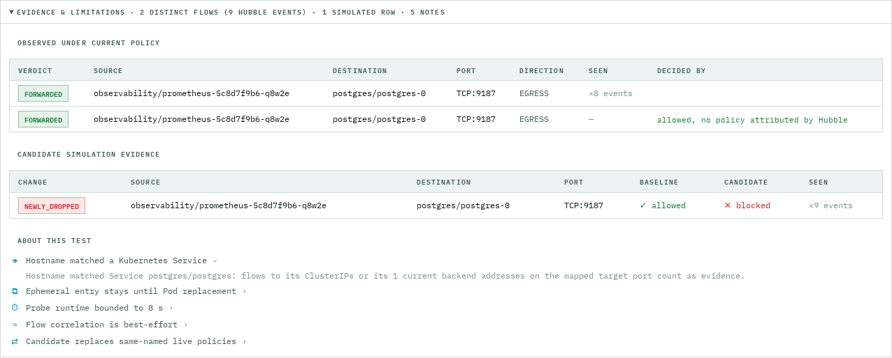
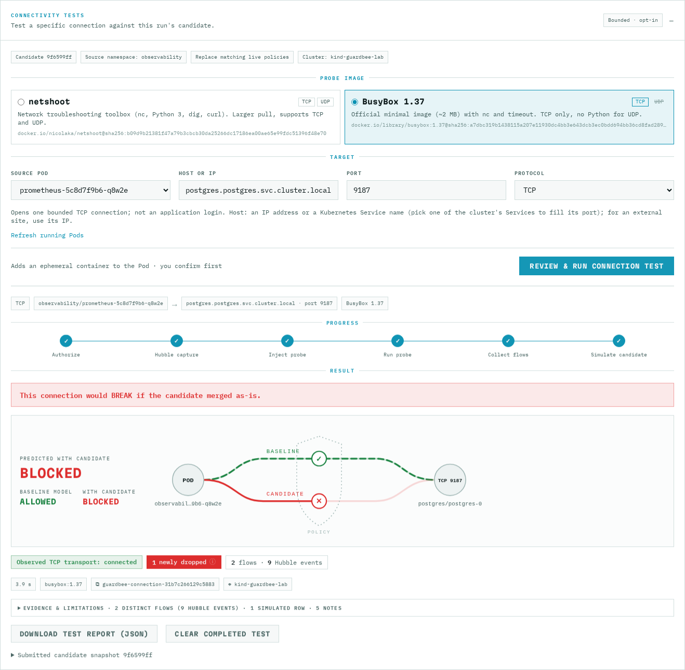

# Opt-in connectivity tests (ephemeral containers)

GuardBee remains read-only by default. TCP/UDP connectivity tests are an explicit exception:
each confirmed request appends a restricted ephemeral container to the chosen
**existing running Linux Pod**. The candidate policy is never applied.

Start with a candidate policy and a selected source Pod and operator-owned
destination. The useful answer is the **candidate's predicted allow/deny** for
real captured traffic, not just whether generating traffic succeeded. The API
also permits diagnostics without a candidate; those requests have no candidate
prediction. No synthetic endpoints or identities are introduced.

```sh
guardbee ui --addr 127.0.0.1:4747 --enable-probes
```

## Probe images

The web UI offers a **catalog** of probe images as cards, each showing which
protocols it can test and whether it is pinned by digest. The browser sends
only the chosen entry's id: it can never type or send an image reference, so
what runs inside a workload is always something the server was started with.
`--enable-probes` is still required either way.

| Startup flags | Images offered |
|---|---|
| `--enable-probes` | The built-in vetted catalog, [`probes/images.yaml`](https://github.com/tchellomello/guardbee/blob/main/probes/images.yaml) |
| `--enable-probes --probe-images-file my-images.yaml` | Your catalog instead (YAML or JSON, same format) |
| `--enable-probes --probe-image <repository:tag-or-digest>` | Exactly that one image, as before |

The built-in catalog ships two images, each checked against a live cluster
under the exact restricted context below with GuardBee's own commands:

| Id | Image | Protocols | Why |
|---|---|---|---|
| `netshoot` | `docker.io/nicolaka/netshoot@sha256:…` | TCP, UDP | Widely used network troubleshooting toolbox: OpenBSD `nc`, Python 3. Larger pull. |
| `busybox` | `docker.io/library/busybox:1.37@sha256:…` | TCP | Official, ~2 MB, `nc` and `timeout`. No Python, so no UDP. |

Your own catalog uses the same format. Unknown fields are rejected at startup,
so a typo fails loudly instead of offering a broken entry:

```yaml
images:
  - id: netshoot-mirror          # lowercase DNS label, unique; what the browser sends
    name: netshoot (corp mirror) # card title, 1-64 characters
    image: registry.corp.example/netshoot@sha256:<64 hex digits>
    protocols: [TCP, UDP]        # only what the image passed; UDP needs Python 3
    description: Mirrored from docker.io for air-gapped clusters.
```

Prefer digests. GuardBee pulls a tag-only image on **every** test
(`imagePullPolicy: Always`; digests use `IfNotPresent`), so a moving tag can
run different code between two tests; the UI marks such entries ⚠. A
private or air-gapped cluster can't pull the built-in Docker Hub references:
mirror them and point `--probe-images-file` at the mirror. The UI won't
offer a protocol the chosen image doesn't list.

## Image requirements

Every image needs compatible
**`timeout` and `nc` binaries on PATH** for
TCP. UDP additionally requires **Python 3 with its standard library**, including
`socket` and `ipaddress`; no dependencies are installed at runtime. It must
support these exact direct argv patterns (no shell):

```text
timeout -k 1s 8s nc -n -z -v -w 5 <unicast-IP-literal> <port>
timeout -k 1s 8s nc -z -v -w 5 <DNS-hostname> <port>
timeout -k 1s 8s python3 -I -c <fixed-GuardBee-UDP-program> <host> <port>
```

Use GNU-compatible timeout (`-k`, duration suffixes), and OpenBSD-compatible
netcat (`-n -z -v -w`). Verify those binaries under UID/GID 65532, no capabilities,
read-only root filesystem, and RuntimeDefault seccomp before enabling probes.
Startup validates the catalog and reference syntax, not binary availability. The
test reports runtime failures explicitly if a required executable is missing.

The UDP program uses `getaddrinfo(AF_UNSPEC, SOCK_DGRAM)`, validates the first
resolved IPv4/IPv6 address, and calls `sendto` **exactly once** with the fixed
27-byte UTF-8/ASCII marker `guardbee-connectivity-probe`. It waits for no reply,
performs no retry, and never permits an arbitrary payload. Unlike `nc -uz`, it
actually generates a datagram. Host and port are separate argv values, never
interpolated into the program. The socket has a five-second timeout; external
`timeout` also bounds DNS resolution. Unsafe resolved addresses (loopback,
link-local, multicast, unspecified, scoped IPv6, and limited broadcast, including
IPv4-mapped IPv6) fail before sending.

**Confirm each request explicitly before submitting it.** For UDP, confirmation
must disclose the selected target/port, one packet, and the exact marker above.
An unexpected marker may be rejected, logged, or interpreted by the target's
application; it is not an application-protocol health check and is not safe to
send blindly to arbitrary database or other endpoints. Choose a target you own
and have approved for this traffic. Missing Python or incompatible executables
produce a failed/inconclusive attempt, not evidence that traffic was generated.

## Safety and permissions

- The writable server binds **only a numeric loopback address**. Open it using
  that exact IP address, not `localhost` or another hostname (a page opened on
  `localhost` is redirected to the numeric address). POST checks JSON
  content type and exact same-origin Origin/Host, rejects DNS hosts and
  cross-site fetches; this prevents DNS rebinding and cross-origin browser
  writes. It is not remote hosting or multi-user authentication.
- Existing read-only RBAC is unchanged. `kubernetes/probes-rbac.yaml` is an
  optional namespace-scoped grant for `pods` get/list,
  `pods/ephemeralcontainers` **update**, and `pods/log` get. Change its namespace
  and subject before applying it yourself. Standard Kubernetes authenticated
  discovery access must also allow SelfSubjectAccessReview creation.
- The existing `guardbee-read` ClusterRole in `kubernetes/rbac.yaml` includes
  `list` on `networking.k8s.io/networkpolicies` across namespaces for the
  simulation completeness check. Both manifests bind the example ServiceAccount
  `guardbee/guardbee`; personal kubeconfig users use their own existing grants
  or an administrator-managed User/Group binding. GuardBee uses client-go directly,
  not a kubectl subprocess, and never applies or grants RBAC itself.
- Each request checks authorization on the exact Pod name and subresources,
  verifies its UID, then re-reads it after capture readiness and submits UID
  plus resourceVersion on the ephemeral-container PUT. Conflicts are not retried.
- No exec into an application container; no labels, ServiceAccount, mounts,
  capabilities, or other workload fields are changed. The injected container
  has no mounts/environment/token, runs nonroot, drops ALL capabilities,
  disables privilege escalation, and uses a read-only filesystem and seccomp.
  Host-network/PID/IPC, shared process namespace, mirror/static, terminating,
  unready, and Windows Pods are excluded. `kube-*`, `cilium-system`, and
  `hubble-system` namespaces are excluded. Other namespaces are constrained
  by the operator's namespace-scoped RBAC and admission policy, not a new CLI
  namespace allowlist. Admission must enforce any further workload/image
  restrictions; GuardBee cannot verify every cluster-specific safety rule.
- At most two requests globally, one per Pod, eight GuardBee entries per Pod,
  and 32 total ephemeral entries. JSON bodies are capped at 256 KiB. Status,
  logs (4 KiB), capture (256 flows), and API calls share a 30-second request
  deadline; Pod enumeration has a 10-second deadline.
- **Ephemeral entries cannot be removed or restarted.** They remain after
  termination until the Pod is replaced by its normal owner. GuardBee never
  deletes/restarts Pods to clean them up. Every attempt consumes one entry.
- HTTP cancellation cancels Kubernetes reads and Hubble capture, but cannot
  kill an already injected container without additional mutation privileges.
   The image's timeout independently stops nc/Python after 8 seconds and force-kills
  after at most one more second. Image pull/scheduling delays are outside that
  command-runtime bound; Kubernetes can start the container after the request
  ends. Probe containers have no resource guarantees, so use carefully on
  sensitive workloads.

## API contract

- `GET /api/probes/capabilities`: `{ "enabled": false }` by default. With
  probes enabled it adds `images`, the catalog the UI picks from: each
  `{ "id", "name", "image", "protocols": ["TCP","UDP"], "description", "pinned" }`
  (`pinned`: referenced by digest). `image` is the default (first) entry's reference.
- `GET /api/probes/pods?namespace=app`: `{ "pods": [{"name":"client","uid":"…"}] }`.
  Requires probes enabled; only eligible running Pods are returned. Optional
  `excluded` maps ineligibility reasons to counts, so an empty picker can explain
  unready Pods, unsupported network/process settings, or an earlier pending test.
- `POST /api/probes/connection`, after explicit per-request UI confirmation:
  `{ "namespace":"app", "pod":"client", "uid":"…", "host":"192.0.2.2", "port":443, "protocol":"TCP", "candidateYAML":"CNP/CCNP YAML" }`.
  `protocol` is required and must be exactly uppercase `TCP` or `UDP`.
  `candidateYAML` is optional for API diagnostics; omit it only when no candidate
  prediction is needed. A supplied candidate is validated before injection.
  `candidateNamespace` defaults independently of the source Pod: omitted uses
  the source namespace for backward compatibility; explicit `""` requires a CNP
  to declare its namespace. `replaceExisting` defaults to true for probes; the
  Web UI always supplies its shared simulation-mode setting. `imageId` picks a
  catalog entry by id (omitted: the default entry); an unknown id, a protocol
  the entry doesn't list, or any raw `image` field is rejected with 400 before
  anything is injected.
- `POST /api/probes/connection/stream`: the same request, reported as NDJSON
  stages and one terminal line; see [Live progress](#live-progress).
- `POST /api/probes/tcp` is the compatibility alias: old requests without
  `protocol` default to TCP and keep optional `candidateYAML`. Explicit TCP is
  accepted; UDP is rejected on this legacy endpoint.
  DNS hostnames (case-insensitive, optional trailing dot) resolve inside the
  Pod, never server-side. Hostname flow correlation needs positive evidence,
  never just the port: an exact normalized Hubble destination name, the flow's
  destination Service, or, for an in-cluster Service name (`<svc>`,
  `<svc>.<ns>`, `<svc>.<ns>.svc[.<cluster-domain>]`), a destination that is one
  of that Service's ClusterIPs or current EndpointSlice addresses, on the
  requested port or the target port it maps to. That last form is read from the
  API (`get` services, `list` endpointslices) because socket-level load
  balancing rewrites the ClusterIP before Hubble sees the packet, so most
  clusters report neither names nor a Service. In the UI, the Host field
  suggests the cluster's Services (`list` services) and picking one fills its
  port; without that permission it suggests the Services seen in this
  session's verdict flows. Any other hostname (an
  external site such as `www.google.com`, a name the Service lookup doesn't
  find) is **refused with `422` before anything is injected**: without Hubble
  DNS visibility nothing on a flow ties it to that name, so the run could only
  end inconclusive. Target the IP instead (resolve it inside the Pod, for
  example with `nslookup`). A Service-shaped name GuardBee may not read
  (`get` services forbidden) still runs, with a warning. Aliases and mesh
  interception stay inconclusive even when traffic generation succeeds.
  Operator network/admission controls must constrain DNS-resolved targets;
  the server cannot safely resolve them in the Pod's DNS context. Loopback, link-local,
  multicast, unspecified, and limited-broadcast targets are rejected because
  they do not provide the intended normal network-policy path.

The result contains `namespace`, `pod`, `host`, `port`, `protocol`, `outcome`
(`connected` for TCP, `generated` for UDP, `failed`, `inconclusive`), `message`, optional `containerName`, `image` and
`imageId` (what was injected), `flows` (the existing `flowOut` API shape plus
`count`: one connection's identical trace events are folded into one row),
optional `simulation` (existing `verdictResponse`, rows folded the same way
the `verdict` command folds them), `warnings` (always an array: this
attempt's own problems), and `notes` (always an array of
`{ "code", "text" }`: the standing caveats every attempt carries). A note's
`code` is stable (`ephemeral-entry`, `runtime-bound`,
`best-effort-correlation`, `service-match`,
`udp-marker`, `nodes-off-path`, `replace-mode`, `additive-mode`,
`policy-replaced`); the UI titles notes by code, never by parsing `text`.
The UI's downloaded test report is `schemaVersion: 2` since `notes` replaced
the earlier `notices` string list. Invalid inputs return
400; disabled/authorization/origin failures 403; stale/ineligible Pods or
entry limits 409; concurrency limits 429. A capture startup failure produces
an inconclusive result and **does not inject** a container. An uncertain
ephemeral update reports its generated name; inspect the Pod before retrying.

Simulation rows add optional `baselineAllowed` and `candidateAllowed` booleans
to the shared verdict JSON shape. Both are derived directly from the engine's
combined source egress and destination ingress decisions. In particular,
`UNCHANGED` with both `false` means **still denied**, not allowed. Both `true`
means still allowed. `NEWLY_DROPPED` is `true` → `false`, and `NEWLY_ALLOWED`
is `false` → `true`. Omitted decisions/unresolved flows mean no prediction;
do not infer a candidate allow from a delta, an empty sample, or runtime outcome.

## Evidence, not policy sign-off

**Evidence & limitations**, under every result, shows what the verdict rests
on: the Hubble flows observed under current policy (one connection's trace
events folded into a row with a count, plus who Hubble says decided it), the
candidate simulation rows with both decisions, and the test's notes, each a
short title that opens to the full explanation.

<div class="shot">
<div class="shot-titlebar"><span class="shot-dot red"></span><span class="shot-dot yellow"></span><span class="shot-dot green"></span><span class="shot-label">guardbee ui · verdict — connectivity test evidence</span></div>

</div>

Capture starts before injection and waits for GetFlows headers and the source
node's NODE_CONNECTED event as a relay availability health gate. This is not
an acknowledgement that the source-node collector has subscribed: relay marks
nodes connected before the collector's GetFlows goroutine runs. This race is
best-effort, and missing evidence is explicitly inconclusive. Capture correlates
outgoing TCP/UDP flows by exact namespace/Pod, protocol, destination IP or normalized Hubble
destination DNS name, port, and attempt window, excluding replies.
**Attribution remains best-effort:** Hubble does not identify the ephemeral
container, and the generated source port is not known. Concurrent application traffic
to the same destination can appear in the result. Service DNAT, clock skew,
relay buffering, dropped events, or unavailable nodes can also hide evidence.

An nc failure alone never means POLICY_DENY. Connection refusal, routing,
timeouts, image/admission failures, and missing status can all differ from a
policy drop. Only Hubble's own attribution/drop reason supplies a live policy
decision. A successful connection is not an application health check.

UDP `generated` means only that the fixed program's `sendto` returned. It does
**not** mean delivered, reachable, listening, healthy, or allowed by policy.
UDP may send successfully even if the datapath drops the packet. Use actual
Hubble evidence and the candidate's engine decision as separate signals.

Simulation uses the same real pinned Cilium engine (`judgeFlow`, shared
`buildVerdictEnginesWith` rule-construction core, `toVerdictResponse`), with
the **full cluster-wide CNP/CCNP inventory** so a destination in another
namespace retains its ingress policy. The inspected inventory is the one
used for engine construction, not a second potentially changed list. Candidate
semantics follow Verdict's shared **Replace matching live policies** setting.
Replacement removes policies with the same kind, namespace, and name only from
the candidate engine; the original baseline remains unchanged. Turning the
setting off explicitly selects additive simulation, which can retain permissions
removed by an edited candidate. The submitted snapshot records the chosen mode.
A Kubernetes NetworkPolicy in a correlated flow's source or destination
namespace, or inability to read those namespaces' inventory, suppresses
simulation because those policies are not part of this engine baseline. A
NetworkPolicy's podSelector only selects Pods in its own namespace, so ones
elsewhere in the cluster cannot enforce on the tested flow and are ignored.
The same scoping applies to CNPs' agent-side semantics (FQDN/L7 proxy,
toServices, named ports, authentication): only CNPs in those namespaces, any
CCNP, and the candidate suppress simulation; out-of-scope CNPs still go to the
engine. Likewise a Hubble node reported unavailable only makes the capture
incomplete when it is the source Pod's node, or may be the destination's (a
Pod destination with no destination-side events). The shipped read
ClusterRole grants the NetworkPolicy, Service and EndpointSlice reads.

`cidrGroupRef` or `cidrGroupSelector` in any baseline/candidate suppresses simulation with an explicit
**unverified** warning. Cilium's real agent injects CIDR-group labels through
IPcache; existing Hubble identities may already carry those labels and the
engine can select them. What is not reproduced/verified here is membership and
new candidate identity injection. GuardBee does not manually translate groups
to CIDRs or issue a reassuring result from incomplete context. FQDN/L7 proxy
semantics and baseline parse errors likewise suppress probe simulation.
Authentication requirements (including test-always-fail), agent-resolved
`toServices`, and named ports also suppress simulation: the standalone
endpoint owner does not provide those agent-side mechanisms. Deprecated raw
baseline fields are checked before Parse can silently discard them.
Lost-event notifications, capture errors, overflow, or deadline cancellation
suppress simulation while preserving actual observed flows and TCP/UDP runtime outcome.
The bounded relay drain is two seconds, outside the attempt's correlation
window; collector readiness and relay delivery still remain best-effort.
Missing or unresolved flow evidence is never a pass.

## Reviewing and diagnosing a test

Each verdict run's card has its own **Connectivity tests** section, which tests
that run's frozen candidate, scope and replace/additive mode, so a result always
belongs to the policy version that run judged; editing the Verdict form later
doesn't touch it. One test runs at a time across all runs, a live-following run
can't be tested until it stops, and while a test is in flight neither a new run
nor removing that run's card is allowed (either could drop the result). Its
headline compares the **baseline model** with the candidate; actual Hubble
observations and traffic-generation status are separate evidence. Changing the
test's own inputs (Pod, host, port, image) marks an older result stale without
rewriting the submitted snapshot. **Download test report (JSON)** preserves the exact request,
candidate, response, cluster context, configured image reference, Pod UID, and timing for review.
In all-namespaces mode, choosing a source namespace does not supply a missing
candidate namespace: a namespaced CNP must declare its own `metadata.namespace`.

A previous GuardBee container that is still pending or running blocks another
test on that Pod, including after a client disconnect or server restart. Inspect
the named container; do not restart the workload just to retry. Image-pull and
container-creation errors are surfaced explicitly. Missing executables or an
unverified runtime cannot yield a prediction from unrelated workload traffic.

## Live progress

The UI calls `POST /api/probes/connection/stream`, which reports each stage
as it happens, one NDJSON line each (`{"stage":"capture"}`), then exactly one
terminal line, `{"result":{…}}` or `{"error":"…","status":409}`. Stages, in
order: `authorize`, `capture`, `inject`, `run`, `collect`, `simulate` (only
when a candidate is simulated). The stepper only shows stages the server
reported, never a timer's guess; a stage never reached shows as skipped. A
rejection before the first stage stays an ordinary HTTP status. A rejection
after it keeps the same status in its error line, so "nothing was injected"
means the same thing on both endpoints. A stream that ends with no terminal
line is treated as uncertain: something may already have been injected.
`POST /api/probes/connection` keeps answering with one JSON response.

The result is drawn as the path the traffic took: the source Pod, the policy
gate, and the destination, with one lane for the live baseline and one for
the candidate. An allowed lane flows end to end, a blocked lane stops at the
gate, and an inconclusive lane is dashed with a "?".

<div class="shot">
<div class="shot-titlebar"><span class="shot-dot red"></span><span class="shot-dot yellow"></span><span class="shot-dot green"></span><span class="shot-label">guardbee ui · verdict — connectivity test</span></div>

</div>

## Troubleshooting an inconclusive test

Start the server with `--debug` (`guardbee ui --debug --enable-probes …`). For
each test it logs, to stderr only: the Service a hostname resolved to (its
address and port counts), the exact Hubble filter, relay node state changes,
the probe container's own output (for example `nc`'s resolved address), one
line per captured flow with the reason it was or wasn't correlated
(`destination IP differs`, `outside the probe container's run window`, …), and
which namespace's Kubernetes NetworkPolicy gated the simulation. The UI shows
the attempt's own problems as warnings; the standing caveats every test
carries are under **Evidence & limitations → About this test**.
